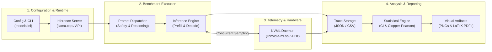

# LLM Research Bench

[](LICENSE)
[](pyproject.toml)
[](https://github.com/AndersonTavares0/llm-research-bench/actions/workflows/ci.yml)
[-red.svg)](reports/en-US/report_en-US.pdf)
[-red.svg)](reports/pt-BR/report_pt-BR.pdf)
[](README.md)
[](README.pt-BR.md)

> **Empirical Exploration of Small Language Models (SLMs) on Resource-Constrained Hardware ($\le 4\text{ GiB}$ VRAM)**<br/>
> A personal, educational, and open-source experimental project investigating memory limits, generation throughput, speculative decoding, and defensive safety behavior on an entry-level GPU (NVIDIA GeForce GTX 1050 Ti 4 GB).

**Author:** Anderson Tavares (Undergraduate Student in Software Engineering and Data Science)<br/>
**Project Repository:** [https://github.com/AndersonTavares0/llm-research-bench](https://github.com/AndersonTavares0/llm-research-bench)<br/>
**Language:** **English** | [Versão em Português](README.pt-BR.md)

---

> [!NOTE]
> **Project Nature & Disclaimer**<br/>
> This is an independent personal project developed for learning, experimentation, and exploratory engineering. While it applies structured benchmarks, monotonic timing, and statistical calculations, **it is not a peer-reviewed academic publication**. Results reflect observed behavior on a specific single-GPU testbed and are subject to ongoing refinement. See [Limitations and Ongoing Work](#limitations-and-ongoing-work) and [Issue #2](https://github.com/AndersonTavares0/llm-research-bench/issues/2).

---

## Table of Contents

- [Overview](#overview)
- [Why This Project?](#why-this-project)
- [What Does It Evaluate?](#what-does-it-evaluate)
- [How It Works](#how-it-works)
- [Hardware and Environment](#hardware-and-environment)
- [Evaluated Models and Configurations](#evaluated-models-and-configurations)
- [Key Empirical Results](#key-empirical-results)
- [Getting Started](#getting-started)
- [Experiment Reproducibility](#experiment-reproducibility)
- [Repository Structure](#repository-structure)
- [Limitations and Ongoing Work](#limitations-and-ongoing-work)
- [Project Status and Roadmap](#project-status-and-roadmap)
- [Full Documentation](#full-documentation)
- [License and Acknowledgments](#license-and-acknowledgments)

---

## Overview

Modern Small Language Models (SLMs)—parameterized between **0.5B and 4B parameters**—make local, private, and deterministic text generation feasible on consumer hardware. However, running these models on accelerators with rigid physical boundaries ($\le 4096\text{ MiB}$ VRAM) creates severe engineering challenges:

- Model weights easily saturate 40% to 75% of available video memory.
- Dynamic Key-Value (KV) cache expansion during multi-turn generation risks abrupt Out-of-Memory (OOM) crashes.
- Older microarchitectures (such as NVIDIA Pascal GP107) lack specialized Tensor Cores, leaving autoregressive token generation heavily bound by DRAM bus bandwidth.

**LLM Research Bench** provides an automated Python test harness, asynchronous NVML telemetry logger, statistical calculation engine, and reproducible reporting pipeline to measure and understand these bottlenecks in practice.

---

## Why This Project?

1. **Practical Accessibility:** Most state-of-the-art AI benchmarks run on enterprise GPUs (A100, H100). This project tests what actually happens on widely available, low-power consumer hardware (GTX 1050 Ti 4 GB, 75W TDP).
2. **Beyond Marketing Claims:** Rather than relying on generic tok/s numbers, the project continuously logs physical device allocations (MiB), junction temperature, Time-to-First-Token (TTFT), and prefill vs. decode speeds.
3. **Understanding Acceleration Techniques:** It examines whether techniques like non-uniform importance-matrix quantization (`IQ4_XS`) and speculative Multi-Token Prediction (`MTP`) provide real-world advantages on hardware without INT4 tensor acceleration.

---

## What Does It Evaluate?

The bench evaluates both operational system performance and behavioral model quality:

| Evaluation Dimension | Metric / Target | How It Is Measured |
| :--- | :--- | :--- |
| **Decode Throughput** | Generation tokens/s | Monotonic clock timing across sequential token generation passes ($\tau = 0.0$, greedy) |
| **Context Processing (Prefill)** | Prompt tokens/s | Batch prompt evaluation rate prior to generating the first token |
| **Latency & TTFT** | Time-to-First-Token (ms) | Client-perceived response delay, documenting first-trial cold-start vs. steady state |
| **Physical VRAM Allocation** | Peak Device Memory (MiB) | Continuous NVML ctypes telemetry sampled at 250 ms (4 Hz) |
| **Bandwidth Demand Proxy** | Analytical DRAM Demand (GB/s) | Analytical proxy ($B_{\text{demand}} = S_{\text{weights}} \times \text{Throughput}_{\text{decode}}$) relative to 112 GB/s theoretical bus |
| **Quantization & MTP** | Throughput & Memory Delta | Controlled observational comparisons on fixed Gemma-4-E2B architecture |
| **Multilingual Tokenization** | Token Fertility (tokens/word) | Parallel analysis across 12 standardized text pairs in English, Portuguese, and Mandarin |
| **Exploratory Defensive Safety** | Attack Success Rate (ASR) & FPR | 10 single-turn canary probes with exact Clopper-Pearson 95% confidence intervals |

---

## How It Works

The benchmark suite coordinates configuration loading, runtime health checks, background telemetry, prompt dispatching, and statistical export in a deterministic pipeline:



### Core Python Components (`src/llm_research_bench/`)

- [`benchmark_suite.py`](src/llm_research_bench/benchmark_suite.py): Central test orchestrator featuring a standardized 3-tier protocol (Level A Smoke Test, Level B Comparative, Level C Thermal Stress), monotonic timing profilers, and thermal guardrails.
- [`telemetry_collector.py`](src/llm_research_bench/telemetry_collector.py): Dedicated background thread interacting directly with the NVIDIA Management Library (`libnvidia-ml.so.1`) to record peak VRAM and temperature.
- [`statistical_engine.py`](src/llm_research_bench/statistical_engine.py): Mathematical module computing Student's $t$ confidence intervals and exact Clopper-Pearson binomial intervals.
- [`generate_figures.py`](src/llm_research_bench/generate_figures.py) & [`generate_readme_figures.py`](src/llm_research_bench/generate_readme_figures.py): Automated chart generators producing publication-grade vector PDFs and README PNG figures directly from recorded results.

---

## Hardware and Environment

All empirical results in this repository were collected on a dedicated, physical reference testbed:

| Component | Specification | Operational Context |
| :--- | :--- | :--- |
| **GPU** | NVIDIA GeForce GTX 1050 Ti (Pascal GP107) | 4096 MiB GDDR5, 128-bit bus, 112.0 GB/s bandwidth, 768 CUDA cores, Compute Capability 6.1, 75W TDP |
| **Tensor Acceleration** | **None** (No Tensor Cores) | FP16 processing is executed at 1:64 rate; inference relies on standard FP32/INT8 CUDA execution |
| **Host CPU** | AMD Ryzen 5 3600 (6 Cores / 12 Threads @ 3.6 GHz base) | System host controller |
| **System Memory** | 16 GiB DDR4 @ 3200 MT/s | System host RAM |
| **Sandbox Environment** | Dedicated Debian 12 minimal container | Direct PCI Passthrough; headless execution without X11 or desktop compositors competing for VRAM |
| **Inference Engine** | `llama-server` (llama.cpp build b4120+) | cuBLAS offload, native GGUF loader |

---

## Evaluated Models and Configurations

> [!IMPORTANT]
> **Models vs. Experimental Configurations**<br/>
> The benchmark evaluated **6 distinct foundational model architectures** across **8 experimental operational configurations** (including quantization levels and speculative MTP variants).

| Configuration Identifier | Foundational Model | Quantization Format | Speculative MTP | Nominal Params | Peak VRAM (Device) | VRAM % of 4 GiB |
| :--- | :--- | :--- | :---: | :---: | :---: | :---: |
| `qwen2.5:0.5b` | **Qwen-2.5-0.5B** | `Q4_K_M` | No | 0.49B | 620.7 MiB | 15.2% |
| `smollm2:1.7b` | **SmolLM2-1.7B** | `Q4_K_M` | No | 1.71B | 2902.7 MiB | 70.9% |
| `gemma4:C1` | **Gemma-4-E2B** | `Q4_K_M` (Base) | No | 2.00B | 1996.7 MiB | 48.7% |
| `gemma4:C2` | **Gemma-4-E2B** | `IQ4_XS` (Base) | No | 2.00B | 1800.7 MiB | 44.0% |
| `gemma4:C3` | **Gemma-4-E2B** | `IQ4_XS` | **Yes (MTP)** | 2.00B (2.30B header)* | 2036.7 MiB | 49.7% |
| `qwen3.5:2b` | **Qwen-3.5-2B** | `Q4_K_XL` | No | 1.95B | 1580.7 MiB | 38.6% |
| `llama3.2:3b` | **Llama-3.2-3B** | `Q4_K_M` | No | 3.21B | 3074.7 MiB | 75.1% |
| `qwen3.5:4b` | **Qwen-3.5-4B** | `Q4_K_M` | No | 4.02B | 3140.7 MiB | 76.7% |

*\* Note: Gemma-4-E2B with MTP reports 2.30B total parameters in its GGUF header because auxiliary speculative prediction heads (quantized in Q8_0) are embedded directly within the weight container.*

---

## Key Empirical Results

### 1. Throughput vs. VRAM Trade-off & Configuration Map

The figure below plots observed generation throughput (greedy decode, tokens/s) against measured peak device memory (MiB via NVML). Points **[1] through [8]** represent empirical configurations tested on the physical NVIDIA GeForce GTX 1050 Ti.


| Point | Model & Operational Configuration | Foundational Architecture | Format / Quantization | Peak VRAM (MiB) | % of 4 GiB | Decode (tok/s) |
| :---: | :--- | :--- | :--- | :---: | :---: | :---: |
| **[1]** | **Qwen-2.5-0.5B** | Qwen2.5 (0.49B) | `Q4_K_M` | **620.7** | 15.2% | **97.47 ± 0.60** |
| **[2]** | **Qwen-3.5-2B** | Qwen (1.95B) | `Q4_K_XL` | 1580.7 | 38.6% | 37.60 ± 0.10 |
| **[3]** | **Gemma-4-E2B [C2]** | Gemma 2 (2.00B) | `IQ4_XS` Base | 1800.7 | 44.0% | 34.51 ± 0.29 |
| **[4]** | **Gemma-4-E2B [C1]** | Gemma 2 (2.00B) | `Q4_K_M` Base | 1996.7 | 48.7% | 26.92 ± 0.23 |
| **[5]** | **Gemma-4-E2B [C3]** | Gemma 2 (2.00B) | `IQ4_XS` + **MTP** | 2036.7 | 49.7% | **43.35 ± 0.57** |
| **[6]** | **SmolLM2-1.7B** | LLaMA (1.71B) | `Q4_K_M` | 2902.7 | 70.9% | 47.80 ± 0.10 |
| **[7]** | **Llama-3.2-3B** | Llama 3.2 (3.21B) | `Q4_K_M` | 3074.7 | 75.1% | 27.59 ± 0.04 |
| **[8]** | **Qwen-3.5-4B** | Qwen (4.02B) | `Q4_K_M` | 3140.7 | 76.7% | 18.55 ± 0.10 |

> [!NOTE]
> **Pareto Dominance Criteria & Trade-offs:**<br/>
> If evaluated purely on the bivariate tuple `(min VRAM, max Throughput)`, Point **[1] (Qwen-0.5B)** strictly Pareto-dominates all other points on this testbed. However, real-world deployment requires balancing throughput against model reasoning capacity, knowledge density, and context retention. Points **[2]**, **[5]**, and **[6]** represent the most practical engineering trade-offs between model intelligence and memory headroom, while 3B--4B models (**[7]**, **[8]**) leave minimal VRAM headroom for multi-turn KV cache growth.

### 2. Controlled Observational Comparison: Quantization & MTP

To examine the separate effects of tensor quantization and speculative execution, we conducted controlled observations on a fixed architecture (**Gemma-4-E2B**) across 10 sequential iterations ($\tau = 0.0$):


- **Quantization Shift (C2 vs. C1):** Moving from standard `Q4_K_M` to importance-matrix `IQ4_XS` without speculative decoding yielded a **+28.2% throughput increase** ($26.92 \to 34.51\text{ tok/s}$) while reducing physical VRAM by **196.0 MiB** ($1996.7 \to 1800.7\text{ MiB}$).
- **Speculative MTP Shift (C3 vs. C2):** Under constant `IQ4_XS` quantization, enabling Multi-Token Prediction (MTP) draft heads added **+25.6% throughput** ($34.51 \to 43.35\text{ tok/s}$) with an observed runtime memory allocation of **+236.0 MiB** for draft heads and speculative buffers.
- **Combined Operating Difference (C3 vs. C1):** The overall difference between the baseline configuration and the MTP-optimized setup reached **+61.0%** ($26.92 \to 43.35\text{ tok/s}$). Because the 196 MiB savings from quantization absorbed 83% of the MTP memory overhead, the net memory increase was only **+40.0 MiB** ($1996.7 \to 2036.7\text{ MiB}$).

> [!NOTE]
> *Methodological Note:* These represent controlled observational comparisons on a single model architecture in this specific test environment. They are not claimed as a complete causal factorial decomposition across all hardware.

### 3. Summary Performance Table

| Configuration | Mean Decode (tok/s) | Steady TTFT (ms) | Prefill (tok/s) | Analytical Bus Demand | Memory Efficiency (tok/s/GiB) |
| :--- | :---: | :---: | :---: | :---: | :---: |
| **Qwen-2.5-0.5B** (`Q4_K_M`) | **97.47 ± 0.60** | **12.1** | 237.1 | 45.7 GB/s (40.8%) | **160.8** |
| **SmolLM2-1.7B** (`Q4_K_M`) | 47.80 ± 0.10 | 25.5 | 103.3 | 50.6 GB/s (45.2%) | 16.9 |
| **Gemma-4-E2B** (`IQ4_XS + MTP`) | 43.35 ± 0.57 | 73.5* | 62.2 | **75.3 GB/s (67.2%)** | 21.8 |
| **Qwen-3.5-2B** (`Q4_K_XL`) | 37.60 ± 0.10 | 49.9 | 126.5 | 52.5 GB/s (46.9%) | 24.4 |
| **Gemma-4-E2B** (`IQ4_XS Base`) | 34.51 ± 0.29 | 88.0 | 79.2 | 60.0 GB/s (53.6%) | 19.6 |
| **Llama-3.2-3B** (`Q4_K_M`) | 27.59 ± 0.04 | 43.5 | 59.6 | 55.7 GB/s (49.7%) | 9.2 |
| **Gemma-4-E2B** (`Q4_K_M Base`) | 26.92 ± 0.23 | 116.1 | 65.5 | 53.7 GB/s (47.9%) | 13.8 |
| **Qwen-3.5-4B** (`Q4_K_M`) | 18.55 ± 0.10 | 129.8 | 49.3 | 47.8 GB/s (42.7%) | 6.1 |

*\* Note on TTFT Cold-Start:* In initial trials without warmup, Gemma-4-E2B exhibited a cold-start TTFT of 4142.2 ms due to CUDA kernel compilation and initial buffer allocation. Once warm, steady-state median TTFT dropped to 73.5 ms (p95: 2311.4 ms).

### 4. Exploratory Defensive Safety & Multilingual Behavior

- **Benign Canary Over-Refusal:** Across 4 benign technical prompts containing security keywords (e.g., explaining buffer overflows defensively), all tested models achieved a 0% false refusal rate ($0/4$, $\text{FPR} = 0.0\%$, exact Clopper-Pearson 95% CI $[0.0\%, 60.2\%]$).
- **Indirect Prompt Injections:** Models below 2B parameters showed high vulnerability to context-embedded delimiter injections ($\text{ASR} \approx 50\%\text{--}100\%$).
- **Tool Interception:** When injected prompts attempted malicious tool execution, the client-side harness interceptor successfully blocked 100% of calls ($2/2$, $[15.8\%, 100.0\%]$), ensuring 0% host execution.
- **Multilingual Tokenizer Overhead:** Tokenizer vocabulary scale creates severe efficiency disparities. In SmolLM2 (49k vocabulary), Portuguese text required $2.4\times$ more tokens and Mandarin required $4.6\times$ more tokens than equivalent English text, reducing effective 4k context capacity to only $22\%$. Wider vocabularies (Qwen2.5 with 152k, Gemma with 256k) retained 55% to 71% relative context capacity.

---

## Getting Started

### Prerequisites

- **OS:** Linux (Ubuntu 22.04 / Debian 12 recommended) or Windows 10/11 with Python 3.10+
- **GPU (Optional for analysis):** NVIDIA GPU with proprietary driver (for NVML telemetry). Benchmarking scripts can run mock passes without a physical GPU.
- **Git**

### Installation

```bash
# Clone the repository
git clone https://github.com/AndersonTavares0/llm-research-bench.git
cd llm-research-bench

# Create and activate a virtual environment
python -m venv .venv
source .venv/bin/activate  # On Windows: .venv\Scripts\activate

# Install dependencies in editable mode
pip install -e .
```

### Running Verified Automated Tests

The repository includes a comprehensive unit test suite covering statistical engines, telemetry parsing, Clopper-Pearson calculations, and guardrails:

```bash
# Run all 64 unit tests (takes ~0.2s out-of-the-box)
python -m unittest discover -s tests -p "test_*.py"
```

### Running a Quick Smoke Benchmark (Level A)

To execute an end-to-end benchmark pass against an active local inference server (e.g. `llama-server` on `http://127.0.0.1:18081`):

```bash
# Set PYTHONPATH to include src, or install via pip install -e .
python src/llm_research_bench/benchmark_suite.py --base-url http://127.0.0.1:18081 --models gemma4:E2B --tier tier_a
```

*(Note: Requires an active OpenAI-compatible or llama.cpp endpoint. In offline environments without a running server, use the automated test suite above to verify all benchmark pipelines and guardrails.)*

### Regenerating Figures

All publication-grade vector PDF figures and README PNG images can be regenerated directly from recorded empirical data:

```bash
# Generate README PNG charts (docs/images/)
python src/llm_research_bench/generate_readme_figures.py

# Generate academic vector PDF charts (reports/figures/)
python src/llm_research_bench/generate_figures.py
```

### Compiling Technical Reports

The in-depth 20-page and 30-page scientific monographs can be compiled from source using [Tectonic](https://tectonic-typesetting.github.io/):

```bash
# Compile English monograph
tectonic reports/en-US/report_en-US.tex --outdir reports/en-US

# Compile Portuguese monograph
tectonic reports/pt-BR/report_pt-BR.tex --outdir reports/pt-BR
```

---

## Experiment Reproducibility

To ensure auditability, each experiment records:

1. **Model Provenance:** GGUF file size, layer counts, context window, and verified cryptographic SHA-256 hash (see [datasets/model_provenance.json](datasets/model_provenance.json)).
2. **Deterministic Sampling:** Greedy generation ($\tau = 0.0$) with fixed `seed=42`.
3. **Execution Telemetry:** Monotonic timing for each query pass, accompanied by NVML device samples.
4. **Data Isolation:** System telemetry is stored separately in [`results/system_performance/`](results/system_performance/) and quality evaluations in [`results/model_quality/`](results/model_quality/).

> [!WARNING]
> *Cross-Hardware Reproducibility:* Absolute token throughput and millisecond latencies depend on hardware, driver version, memory timings, and operating temperature. Re-running these benchmarks on different GPUs will yield different numerical values.

---

## Repository Structure

```
llm-research-bench/
├── configs/                             # Benchmark matrix and model definitions
│   ├── experiment_matrix.yaml
│   └── models.ini
├── datasets/                            # Evaluation datasets and prompts
│   ├── multilingual/                    # Trilingual parallel reference corpus
│   ├── sensitive_topics/                # Sensitive topics evaluation suite
│   ├── agentic_tools.json               # JSON Schema tool definitions
│   ├── defensive_safety_benchmarks.json # Canary safety evaluation probes
│   ├── model_provenance.json            # SHA-256 cryptographic hashes
│   └── reasoning_prompts.json           # Reasoning prompts
├── docs/                                # Technical documentation and assets
│   ├── images/                          # Visual PNG charts for documentation
│   └── GOVERNANCE.md                    # Project governance and guidelines
├── reports/                             # In-depth technical monographs
│   ├── en-US/                           # English report (LaTeX & PDF)
│   ├── pt-BR/                           # Portuguese report (LaTeX & PDF)
│   └── figures/                         # Vector PDF figures
├── results/                             # Empirical microdata and telemetry traces
│   ├── controlled_experiments/          # Ablation logs and statistical summaries
│   ├── model_quality/                   # Safety and reasoning scoring outputs
│   └── system_performance/              # Asynchronous NVML metrics and JSONs
├── src/llm_research_bench/              # Core benchmark package
│   ├── evaluators/                      # Evaluation modules (safety, code, reasoning)
│   ├── systems/                         # KV cache and concurrency profilers
│   ├── benchmark_suite.py               # 3-tier benchmark orchestrator
│   ├── generate_figures.py              # Vector PDF figure generator
│   ├── generate_readme_figures.py       # Web PNG figure generator
│   ├── statistical_engine.py            # CI and statistical formulas
│   └── telemetry_collector.py           # Native NVML ctypes sampler
├── tests/                               # 64 unit tests (100% passing)
├── CONTRIBUTING.md                      # Contribution guidelines
├── LICENSE                              # MIT License
├── pyproject.toml                       # Build metadata and dependencies
├── README.md                            # Primary documentation (English)
└── README.pt-BR.md                      # Primary documentation (Português)
```

---

## Limitations and Ongoing Work

In accordance with open scientific practice, this project explicitly documents its methodological boundaries and pending research items:

- **Single Physical GPU (Pseudoreplication):** All empirical repetitions were conducted on a single physical GTX 1050 Ti node. High statistical significance ($t$-test values) indicates tight internal consistency across runs on this specific machine, but does not capture variance across different physical devices (*Hurlbert, 1984*).
- **Small-Sample Safety Canaries ($N=10$):** The defensive safety and tool-calling evaluations are exploratory canaries designed to observe behavioral failure modes under single-turn prompts. They do not constitute exhaustive psychometric alignment benchmarks.
- **Analytical Bandwidth Demand vs. Physical Counters:** Memory bandwidth utilization is modeled analytically ($B_{\text{demand}} = S_{\text{weights}} \times \text{Throughput}$), reflecting Roofline memory bus demand rather than hardware DRAM counter reads.
- **Thermal Drift in Continuous Batches:** In uninterrupted test runs, device temperature rose from $44^\circ\text{C}$ to $74^\circ\text{C}$, triggering NVIDIA GPU Boost 3.0 clock scaling ($1695 \to 1607\text{ MHz}$, $-5.2\%$). The new 3-tier protocol incorporates cooldown periods to address this in future runs.
- **Tracking Open Issues:** All active methodological discussions and planned experimental expansions are tracked in **[Issue #2: Ongoing Research and Methodological Review](https://github.com/AndersonTavares0/llm-research-bench/issues/2)**.

---

## Project Status and Roadmap

| Capability / Milestone | Current Status | Notes |
| :--- | :---: | :--- |
| **NVML Telemetry Pipeline** | ✅ Implemented | Asynchronous sampling at 250 ms via ctypes |
| **Standardized 3-Tier Protocol** | ✅ Implemented | Level A (smoke), Level B (interleaved), Level C (thermal stress) |
| **Statistical Engine & CIs** | ✅ Implemented | Student's $t$ and exact Clopper-Pearson 95% intervals |
| **Automated Unit Tests** | ✅ Implemented | 64 unit tests passing out-of-the-box |
| **In-Depth Academic Monographs** | ✅ Implemented | 20-page (EN) and 30-page (PT) PDFs compiled via Tectonic |
| **Multi-Node Hardware Validation** | ⏳ Planned | Expanding benchmarks to secondary edge GPUs (e.g. RTX 3050 6GB) |
| **Extended Thermal Stress Campaign** | ⏳ Planned | Executing Level C sustained runs ($N \ge 50$, 30 minutes) |
| **Expanded Geopolitical Probes** | ⏳ Planned | Executing the sensitive topics evaluation suite defined in datasets |

---

## Full Documentation

For deeper theoretical derivations (Transformer self-attention mathematics, GQA scaling equations, RoPE rotary embeddings, and Roofline arithmetic intensity curves), refer to the full technical monographs:

- 📄 **[English Monograph (PDF, 20 pages)](reports/en-US/report_en-US.pdf)**: Comprehensive systems engineering paper.
- 📄 **[Relatório em Português (PDF, 30 páginas)](reports/pt-BR/report_pt-BR.pdf)**: Monografia técnica completa em português.
- 🛡️ **[Security Policy](SECURITY.md)**: Vulnerability disclosure and defensive testing guidelines.
- 🤝 **[Contributing Guidelines](CONTRIBUTING.md)**: Instructions for submitting improvements.
- 🏛️ **[Project Governance](docs/GOVERNANCE.md)**: Contribution principles and review standards.

---

## License and Acknowledgments

This project is open-source software licensed under the **[MIT License](LICENSE)**.

### Upstream Frameworks and Tools

- **[llama.cpp](https://github.com/ggerganov/llama.cpp)** by Georgi Gerganov and contributors: High-performance local LLM inference engine.
- **[Tectonic](https://tectonic-typesetting.github.io/)**: Modern, self-contained LaTeX compilation engine.
- **Open-weights community:** Alibaba Cloud (Qwen), HuggingFace (SmolLM), Google DeepMind (Gemma), and Meta AI (Llama) for releasing accessible model weights.

---

*This repository is an independent educational initiative by Anderson Tavares. It is not affiliated with, endorsed by, or sponsored by NVIDIA, Google, Meta, Alibaba, or Microsoft.*
