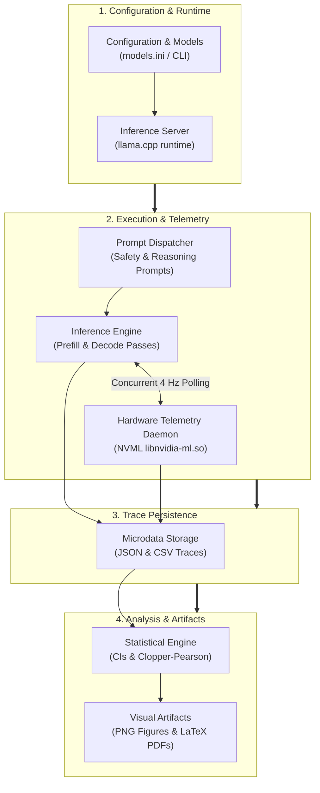

# LLM Research Bench

[](LICENSE)
[](pyproject.toml)
[](https://github.com/AndersonTavares0/llm-research-bench/actions/workflows/ci.yml)
[-red.svg)](reports/en-US/report_en-US.pdf)
[-red.svg)](reports/pt-BR/report_pt-BR.pdf)
[](README.md)
[](README.pt-BR.md)

> **Empirical Exploration of Small Language Models (SLMs) on Resource-Constrained Hardware ($\le 4\text{ GiB}$ VRAM)**<br/>
> A personal, educational, and open-source experimental project investigating memory limits, generation throughput, speculative decoding, and defensive safety behavior on an entry-level GPU (NVIDIA GeForce GTX 1050 Ti 4 GB).

**Author:** Anderson Tavares (Undergraduate Student in Software Engineering and Data Science)<br/>
**Project Repository:** [https://github.com/AndersonTavares0/llm-research-bench](https://github.com/AndersonTavares0/llm-research-bench)<br/>
**Language:** **English** | [Versão em Português](README.pt-BR.md)

---

> [!NOTE]
> **Project Nature & Disclaimer**<br/>
> This is an independent personal project developed for learning, experimentation, and exploratory engineering. While it applies structured benchmarks, monotonic timing, and statistical calculations, **it is not a peer-reviewed academic publication**. Results reflect observed behavior on a specific single-GPU testbed and are subject to ongoing refinement. See [Limitations and Ongoing Work](#5-methodology-limitations--evolution) and [Issue #2](https://github.com/AndersonTavares0/llm-research-bench/issues/2).

---

## Table of Contents

- [1. Overview & Motivation](#1-overview--motivation)
- [2. System Architecture & Workflow](#2-system-architecture--workflow)
- [3. Empirical Findings & Benchmarks](#3-empirical-findings--benchmarks)
- [4. Getting Started & Practical Usage](#4-getting-started--practical-usage)
- [5. Methodology, Limitations & Evolution](#5-methodology-limitations--evolution)

---

## 1. Overview & Motivation

### What Is This Project?

**LLM Research Bench** is a practical experimentation testbed and automated measurement toolkit designed to evaluate **Small Language Models (SLMs, parameterized from 0.5B to 4B)** running locally on commodity physical accelerators with strict memory ceilings ($\le 4096\text{ MiB}$ VRAM).

### Why Test on a 4 GB GTX 1050 Ti?

While frontier AI research primarily targets data-center accelerators (A100, H100), billions of edge and legacy systems rely on accessible consumer hardware. The **NVIDIA GeForce GTX 1050 Ti (Pascal GP107, 4 GB GDDR5, 75W TDP)** serves as a rigorous stress-test platform because:

1. **Rigid Physical Boundary:** A strict 4096 MiB ceiling leaves virtually zero margin for memory bloat; static weights consume 40% to 76% of total VRAM, severely limiting Key-Value (KV) cache expansion.
2. **Zero Tensor Acceleration:** The GP107 microarchitecture lacks Tensor Cores. FP16 arithmetic runs at a restricted 1:64 rate, making autoregressive token generation strictly bound by memory bus bandwidth ($112.0\text{ GB/s}$).
3. **Realistic Edge Conditions:** It demonstrates how techniques like non-uniform quantization (`IQ4_XS`) and Multi-Token Prediction (`MTP`) behave on real consumer silicon without hyperscaler cloud offloading.

### Research Scope & Questions

- **Quantization Impact:** How do importance-matrix quantizations (`IQ4_XS`) compare against standard block quantizations (`Q4_K_M`) in decode throughput and VRAM footprint?
- **Speculative Amortization:** Does Multi-Token Prediction (MTP) deliver practical generation speedups on memory-bound hardware without dedicated draft models?
- **Multilingual Tokenization:** How severely do compact tokenizer vocabularies penalize context capacity and processing time in non-English languages (Portuguese and Mandarin)?
- **Defensive Robustness:** Do compact SLMs reliably isolate untrusted tool outputs from prompt injection attacks in local agentic workflows?

---

## 2. System Architecture & Workflow

The benchmark suite coordinates configuration loading, runtime health checks, background telemetry, prompt dispatching, and statistical export in a structured four-stage lifecycle:



### Core Pipeline Components

- [`benchmark_suite.py`](src/llm_research_bench/benchmark_suite.py): Central test orchestrator featuring a standardized 3-tier protocol (Level A Smoke Test, Level B Comparative, Level C Thermal Stress), monotonic timing profilers, and thermal guardrails.
- [`telemetry_collector.py`](src/llm_research_bench/telemetry_collector.py): Dedicated background thread interacting directly with the NVIDIA Management Library (`libnvidia-ml.so.1`) to record peak VRAM, GPU core clocks, and junction temperature at 250 ms intervals (4 Hz).
- [`statistical_engine.py`](src/llm_research_bench/statistical_engine.py): Mathematical module computing Student's $t$ confidence intervals and exact Clopper-Pearson binomial intervals.
- [`generate_readme_figures.py`](src/llm_research_bench/generate_readme_figures.py): Automated chart generator producing high-clarity PNG figures directly from recorded results.

---

## 3. Empirical Findings & Benchmarks

### Reference Edge Testbed

All empirical measurements were collected on a dedicated, physical testbed:
- **GPU:** NVIDIA GeForce GTX 1050 Ti (4096 MiB GDDR5, 128-bit bus, 112.0 GB/s bandwidth, 768 CUDA cores, Pascal GP107).
- **CPU & Host RAM:** AMD Ryzen 5 3600 (6C/12T @ 3.6 GHz base), 16 GiB DDR4 3200 MT/s.
- **Sandbox Environment:** Debian 12 minimal container with direct PCI passthrough (headless, no X11/desktop VRAM contention).
- **Inference Engine:** `llama-server` (commit b4120+) with cuBLAS offload and GGUF quantization.

### Master Comparison Table (Evaluated Configurations)

> [!IMPORTANT]
> **Foundational Models vs. Operational Configurations:**<br/>
> The benchmark evaluated **6 distinct foundational model architectures** across **8 operational experimental configurations** (including quantization levels and speculative MTP variants).

| Point | Model & Operational Configuration | Foundational Architecture | Format / Quantization | Peak VRAM (MiB) | % of 4 GiB | Decode (tok/s) | Steady TTFT (ms) | Analytical Bus Demand |
| :---: | :--- | :--- | :--- | :---: | :---: | :---: | :---: | :---: |
| **[1]** | **Qwen-2.5-0.5B** | Qwen2.5 (0.49B) | `Q4_K_M` | **620.7** | 15.2% | **97.47 ± 0.60** | **12.1** | 45.7 GB/s (40.8%) |
| **[2]** | **Qwen-3.5-2B** | Qwen (1.95B) | `Q4_K_XL` | 1580.7 | 38.6% | 37.60 ± 0.10 | 49.9 | 52.5 GB/s (46.9%) |
| **[3]** | **Gemma-4-E2B [C2]** | Gemma 2 (2.00B) | `IQ4_XS` Base | 1800.7 | 44.0% | 34.51 ± 0.29 | 88.0 | 60.0 GB/s (53.6%) |
| **[4]** | **Gemma-4-E2B [C1]** | Gemma 2 (2.00B) | `Q4_K_M` Base | 1996.7 | 48.7% | 26.92 ± 0.23 | 116.1 | 53.7 GB/s (47.9%) |
| **[5]** | **Gemma-4-E2B [C3]** | Gemma 2 (2.00B) | `IQ4_XS` + **MTP** | 2036.7 | 49.7% | **43.35 ± 0.57** | 73.5* | **75.3 GB/s (67.2%)** |
| **[6]** | **SmolLM2-1.7B** | LLaMA (1.71B) | `Q4_K_M` | 2902.7 | 70.9% | 47.80 ± 0.10 | 25.5 | 50.6 GB/s (45.2%) |
| **[7]** | **Llama-3.2-3B** | Llama 3.2 (3.21B) | `Q4_K_M` | 3074.7 | 75.1% | 27.59 ± 0.04 | 43.5 | 55.7 GB/s (49.7%) |
| **[8]** | **Qwen-3.5-4B** | Qwen (4.02B) | `Q4_K_M` | 3140.7 | 76.7% | 18.55 ± 0.10 | 129.8 | 47.8 GB/s (42.7%) |

*\* Note on TTFT Cold-Start:* In initial trials without warmup, Gemma-4-E2B exhibited a cold-start TTFT of 4142.2 ms due to CUDA kernel compilation and initial buffer allocation. Once warm, steady-state median TTFT dropped to 73.5 ms (p95: 2311.4 ms).

### Trade-off: Generation Throughput vs. VRAM Footprint

The figure below plots observed generation throughput (greedy decode, tokens/s) against measured peak device memory (MiB via NVML). Points **[1] through [8]** map directly to the Master Comparison Table above:


> [!NOTE]
> **Dominance Criteria & Engineering Trade-offs:**<br/>
> If evaluated strictly on the bivariate tuple `(min VRAM, max Throughput)`, Point **[1] (Qwen-0.5B)** strictly dominates all other points on this testbed. In practical systems engineering, however, selection involves balancing throughput against model parameter scale and memory headroom for multi-turn context expansion. Points **[2]**, **[5]**, and **[6]** offer balanced operating points for 2B-scale architectures, whereas 3B--4B configurations (**[7]**, **[8]**) consume over 75% of memory for static weights alone.

### Controlled Observational Comparison: Quantization & MTP

To examine the separate effects of tensor quantization and speculative execution, we conducted controlled observations on a fixed architecture (**Gemma-4-E2B**) across 10 sequential iterations ($\tau = 0.0$):


- **Quantization Shift (C2 vs. C1):** Moving from standard `Q4_K_M` to importance-matrix `IQ4_XS` without speculative decoding yielded a **+28.2% throughput increase** ($26.92 \to 34.51\text{ tok/s}$) while reducing physical VRAM by **196.0 MiB** ($1996.7 \to 1800.7\text{ MiB}$).
- **Speculative MTP Shift (C3 vs. C2):** Under constant `IQ4_XS` quantization, enabling Multi-Token Prediction (MTP) draft heads added **+25.6% throughput** ($34.51 \to 43.35\text{ tok/s}$) with an observed runtime memory allocation of **+236.0 MiB** for draft heads and speculative buffers.
- **Combined Operating Difference (C3 vs. C1):** The overall difference between the baseline configuration and the MTP-optimized setup reached **+61.0%** ($26.92 \to 43.35\text{ tok/s}$). Because the 196 MiB savings from quantization absorbed 83% of the MTP memory overhead, the net memory increase was only **+40.0 MiB** ($1996.7 \to 2036.7\text{ MiB}$).

> [!NOTE]
> *Methodological Scope:* These represent controlled observational comparisons on a single model architecture in this specific test environment. They are not claimed as a complete causal factorial decomposition across all hardware.

### Defensive Safety & Multilingual Tokenization Highlights

- **Benign Canary Over-Refusal:** Across 4 benign technical prompts containing security keywords (e.g., explaining buffer overflows defensively), all tested models achieved a 0% false refusal rate ($0/4$, $\text{FPR} = 0.0\%$, exact Clopper-Pearson 95% CI $[0.0\%, 60.2\%]$).
- **Indirect Prompt Injections:** Models below 2B parameters showed high vulnerability to context-embedded delimiter injections ($\text{ASR} \approx 50\%\text{--}100\%$).
- **Tool Interception:** When injected prompts attempted malicious tool execution, the client-side harness interceptor successfully blocked 100% of calls ($2/2$, $[15.8\%, 100.0\%]$), ensuring 0% host execution.
- **Multilingual Tokenizer Overhead:** Tokenizer vocabulary scale creates severe efficiency disparities. In SmolLM2 (49k vocabulary), Portuguese text required $2.4\times$ more tokens and Mandarin required $4.6\times$ more tokens than equivalent English text, reducing effective 4k context capacity to only $22\%$. Wider vocabularies (Qwen2.5 with 152k, Gemma with 256k) retained 55% to 71% relative context capacity.

---

## 4. Getting Started & Practical Usage

### Prerequisites & Environment Setup

- **Operating System:** Linux (Ubuntu 22.04 / Debian 12 recommended) or Windows 10/11 with Python 3.10+
- **GPU (Optional for analysis):** NVIDIA GPU with proprietary driver (for NVML telemetry). Benchmarking scripts can run mock passes without a physical GPU.
- **Git**

```bash
# Clone the repository
git clone https://github.com/AndersonTavares0/llm-research-bench.git
cd llm-research-bench

# Create and activate a virtual environment
python -m venv .venv
source .venv/bin/activate  # On Windows: .venv\Scripts\activate

# Install package in editable mode
pip install -e .
```

### Running Verified Software Tests

The repository includes a comprehensive unit test suite covering statistical engines, telemetry parsing, Clopper-Pearson calculations, and guardrails:

```bash
# Run all 64 automated unit tests (execution verified: passes in ~0.2s out-of-the-box)
python -m unittest discover -s tests -p "test_*.py"
```

### Running an End-to-End Benchmark Pass

To execute a benchmark pass against an active local inference server (e.g. `llama-server` on `http://127.0.0.1:18081`):

```bash
# Set PYTHONPATH to include src, or install via pip install -e .
python src/llm_research_bench/benchmark_suite.py --base-url http://127.0.0.1:18081 --models gemma4:E2B --tier tier_a
```

*(Note: Requires an active OpenAI-compatible or llama.cpp endpoint. In offline environments without a running server, use the automated test suite above to verify all benchmark pipelines and guardrails.)*

### Regenerating Visual Artifacts (PNG / PDF)

All publication-grade vector PDF figures and README PNG images can be regenerated directly from recorded empirical data:

```bash
# Generate documentation PNG charts (docs/images/) - verified execution
python src/llm_research_bench/generate_readme_figures.py

# Generate academic vector PDF charts (reports/figures/) - verified execution
python src/llm_research_bench/generate_figures.py
```

### Compiling Technical Monographs (Tectonic)

The in-depth 20-page and 30-page scientific monographs can be compiled from source using [Tectonic](https://tectonic-typesetting.github.io/):

```bash
# Compile English monograph (reports/en-US/report_en-US.pdf) - verified execution
tectonic reports/en-US/report_en-US.tex --outdir reports/en-US

# Compile Portuguese monograph (reports/pt-BR/report_pt-BR.pdf) - verified execution
tectonic reports/pt-BR/report_pt-BR.tex --outdir reports/pt-BR
```

---

## 5. Methodology, Limitations & Evolution

### Repository Structure

```
llm-research-bench/
├── configs/                             # Benchmark matrix and model definitions
│   ├── experiment_matrix.yaml
│   └── models.ini
├── datasets/                            # Evaluation datasets and prompts
│   ├── multilingual/                    # Trilingual parallel reference corpus
│   ├── sensitive_topics/                # Sensitive topics evaluation suite
│   ├── agentic_tools.json               # JSON Schema tool definitions
│   ├── defensive_safety_benchmarks.json # Canary safety evaluation probes
│   ├── model_provenance.json            # SHA-256 cryptographic hashes
│   └── reasoning_prompts.json           # Reasoning prompts
├── docs/                                # Technical documentation and assets
│   ├── images/                          # Visual PNG charts for documentation
│   └── GOVERNANCE.md                    # Project governance and guidelines
├── reports/                             # In-depth technical monographs
│   ├── en-US/                           # English report (LaTeX & PDF)
│   ├── pt-BR/                           # Portuguese report (LaTeX & PDF)
│   └── figures/                         # Vector PDF figures
├── results/                             # Empirical microdata and telemetry traces
│   ├── controlled_experiments/          # Ablation logs and statistical summaries
│   ├── model_quality/                   # Safety and reasoning scoring outputs
│   └── system_performance/              # Asynchronous NVML metrics and JSONs
├── src/llm_research_bench/              # Core benchmark package
│   ├── evaluators/                      # Evaluation modules (safety, code, reasoning)
│   ├── systems/                         # KV cache and concurrency profilers
│   ├── benchmark_suite.py               # 3-tier benchmark orchestrator
│   ├── generate_figures.py              # Vector PDF figure generator
│   ├── generate_readme_figures.py       # Web PNG figure generator
│   ├── statistical_engine.py            # CI and statistical formulas
│   └── telemetry_collector.py           # Native NVML ctypes sampler
├── tests/                               # 64 unit tests (100% passing)
├── CONTRIBUTING.md                      # Contribution guidelines
├── LICENSE                              # MIT License
├── pyproject.toml                       # Build metadata and dependencies
├── README.md                            # Primary documentation (English)
└── README.pt-BR.md                      # Primary documentation (Português)
```

### Reproducibility & Provenance

To ensure auditability, each experiment records:
1. **Model Provenance:** GGUF file size, layer counts, context window, and verified cryptographic SHA-256 hash (see [datasets/model_provenance.json](datasets/model_provenance.json)).
2. **Deterministic Sampling:** Greedy generation ($\tau = 0.0$) with fixed `seed=42`.
3. **Execution Telemetry:** Monotonic timing for each query pass, accompanied by NVML device samples.
4. **Data Isolation:** System telemetry is stored separately in [`results/system_performance/`](results/system_performance/) and quality evaluations in [`results/model_quality/`](results/model_quality/).

> [!WARNING]
> *Cross-Hardware Reproducibility:* Absolute token throughput and millisecond latencies depend on hardware, driver version, memory timings, and operating temperature. Re-running these benchmarks on different GPUs will yield different numerical values.

### Known Methodological Limitations

In accordance with open scientific practice, this project explicitly documents its methodological boundaries:

- **Single Physical GPU (Pseudoreplication):** All empirical repetitions were conducted on a single physical GTX 1050 Ti node. High statistical significance ($t$-test values) indicates tight internal consistency across runs on this specific machine, but does not capture variance across different physical devices (*Hurlbert, 1984*).
- **Small-Sample Safety Canaries ($N=10$):** The defensive safety and tool-calling evaluations are exploratory canaries designed to observe behavioral failure modes under single-turn prompts. They do not constitute exhaustive psychometric alignment benchmarks.
- **Analytical Bandwidth Demand vs. Physical Counters:** Memory bandwidth utilization is modeled analytically ($B_{\text{demand}} = S_{\text{weights}} \times \text{Throughput}$), reflecting Roofline memory bus demand rather than hardware DRAM counter reads.
- **Thermal Drift in Continuous Batches:** In uninterrupted test runs, device temperature rose from $44^\circ\text{C}$ to $74^\circ\text{C}$, triggering NVIDIA GPU Boost 3.0 clock scaling ($1695 \to 1607\text{ MHz}$, $-5.2\%$). The new 3-tier protocol incorporates cooldown periods to address this in future runs.
- **Tracking Open Issues:** All active methodological discussions and planned experimental expansions are tracked in **[Issue #2: Ongoing Research and Methodological Review](https://github.com/AndersonTavares0/llm-research-bench/issues/2)**.

### Full Technical Reports & Citation

For deeper theoretical derivations (Transformer self-attention mathematics, GQA scaling equations, RoPE rotary embeddings, and Roofline arithmetic intensity curves), refer to the full technical monographs:

- 📄 **[English Monograph (PDF, 20 pages)](reports/en-US/report_en-US.pdf)**: Comprehensive systems engineering paper.
- 📄 **[Relatório em Português (PDF, 30 páginas)](reports/pt-BR/report_pt-BR.pdf)**: Monografia técnica completa em português.
- 🛡️ **[Security Policy](SECURITY.md)**: Vulnerability disclosure and defensive testing guidelines.
- 🤝 **[Contributing Guidelines](CONTRIBUTING.md)**: Instructions for submitting improvements.
- 🏛️ **[Project Governance](docs/GOVERNANCE.md)**: Contribution principles and review standards.

If you reference this benchmark methodology or empirical dataset, please cite:

```bibtex
@article{tavares2026slmbench,
  title   = {Reproducible Evaluation of Small Language Models Under Severe Memory and Compute Constraints: Architectural Dynamics, Quantization Frontiers, Speculative Decoding, and Adversarial Vulnerabilities on a Reference Edge Testbed},
  author  = {Tavares, Anderson},
  journal = {Open Technical Report and Benchmark Monograph},
  year    = {2026},
  url     = {https://github.com/AndersonTavares0/llm-research-bench}
}
```

---

## License and Acknowledgments

This project is open-source software licensed under the **[MIT License](LICENSE)**.

### Upstream Frameworks and Tools

- **[llama.cpp](https://github.com/ggerganov/llama.cpp)** by Georgi Gerganov and contributors: High-performance local LLM inference engine.
- **[Tectonic](https://tectonic-typesetting.github.io/)**: Modern, self-contained LaTeX compilation engine.
- **Open-weights community:** Alibaba Cloud (Qwen), HuggingFace (SmolLM), Google DeepMind (Gemma), and Meta AI (Llama) for releasing accessible model weights.

---

*This repository is an independent educational initiative by Anderson Tavares. It is not affiliated with, endorsed by, or sponsored by NVIDIA, Google, Meta, Alibaba, or Microsoft.*
