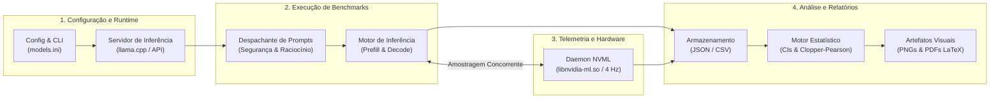

# LLM Research Bench

[](LICENSE)
[](pyproject.toml)
[](https://github.com/AndersonTavares0/llm-research-bench/actions/workflows/ci.yml)
[-red.svg)](reports/pt-BR/report_pt-BR.pdf)
[-red.svg)](reports/en-US/report_en-US.pdf)
[](README.pt-BR.md)
[](README.md)

> **Exploração Empírica de Modelos de Linguagem Pequenos (SLMs) sob Restrições Severas de Memória ($\le 4\text{ GiB}$ VRAM)**<br/>
> Um projeto pessoal, educacional e experimental de código aberto que investiga limites de memória, vazão de geração, decodificação especulativa e comportamento de segurança defensiva em uma GPU de entrada (NVIDIA GeForce GTX 1050 Ti de 4 GB).

**Autor:** Anderson Tavares (Graduando em Engenharia de Software e Ciência de Dados)<br/>
**Repositório do Projeto:** [https://github.com/AndersonTavares0/llm-research-bench](https://github.com/AndersonTavares0/llm-research-bench)<br/>
**Idioma:** **Português (Brasil)** | [English Version](README.md)

---

> [!NOTE]
> **Natureza do Projeto e Aviso Legal**<br/>
> Este é um projeto pessoal independente desenvolvido para aprendizado, experimentação e engenharia exploratória. Embora aplique benchmarks estruturados, temporização monotônica e cálculos estatísticos, **não se trata de uma publicação acadêmica revisada por pares**. Os resultados refletem o comportamento observado em uma bancada de testes física com GPU única e estão sujeitos a revisão contínua. Consulte [Limitações e Trabalho em Andamento](#limitações-e-trabalho-em-andamento) e a [Issue #2](https://github.com/AndersonTavares0/llm-research-bench/issues/2).

---

## Sumário

- [Visão Geral](#visão-geral)
- [Por Que Este Projeto?](#por-que-este-projeto)
- [O Que é Avaliado?](#o-que-é-avaliado)
- [Como Funciona](#como-funciona)
- [Hardware e Ambiente Experimental](#hardware-e-ambiente-experimental)
- [Modelos e Configurações Avaliadas](#modelos-e-configurações-avaliadas)
- [Principais Resultados Empíricos](#principais-resultados-empíricos)
- [Como Começar](#como-começar)
- [Reprodutibilidade dos Experimentos](#reprodutibilidade-dos-experimentos)
- [Estrutura do Repositório](#estrutura-do-repositório)
- [Limitações e Trabalho em Andamento](#limitações-e-trabalho-em-andamento)
- [Status do Projeto e Roadmap](#status-do-projeto-e-roadmap)
- [Documentação Completa](#documentação-completa)
- [Licença e Agradecimentos](#licença-e-agradecimentos)

---

## Visão Geral

Modelos de Linguagem Pequenos (*Small Language Models* - SLMs)—com parâmetros entre **0,5B e 4B**—tornam viável a geração de texto local, privada e determinística em hardware convencional. No entanto, executar esses modelos em aceleradores com limites físicos rígidos ($\le 4096\text{ MiB}$ VRAM) impõe desafios severos de engenharia:

- Os tensores de pesos do modelo consomem sozinhos entre 40% e 75% da memória de vídeo disponível.
- A expansão dinâmica do cache Key-Value (KV) durante conversas mais longas gera risco iminente de encerramento forçado por falta de memória (*Out-of-Memory* - OOM).
- Microarquiteturas mais antigas (como a NVIDIA Pascal GP107) não possuem Tensor Cores dedicados, fazendo com que a geração autorregressiva de tokens fique estritamente limitada pela largura de banda do barramento GDDR5.

O **LLM Research Bench** fornece um conjunto automatizado de testes em Python, coletor assíncrono de telemetria via NVML, motor de análise estatística e pipeline de relatórios reprodutíveis para mensurar e compreender esses gargalos na prática.

---

## Por Que Este Projeto?

1. **Acessibilidade Prática:** A maioria dos benchmarks de inteligência artificial de ponta é executada em GPUs corporativas (A100, H100). Este projeto investiga o que realmente acontece em hardware doméstico de baixo consumo (GTX 1050 Ti de 4 GB, TDP de 75W).
2. **Além de Promessas Teóricas:** Em vez de depender apenas de números genéricos de tokens/s, o projeto monitora de forma contínua alocações reais de memória física (MiB), temperatura da GPU, latência até o primeiro token (TTFT) e velocidades de processamento de contexto (*prefill*) versus geração (*decode*).
3. **Entendimento de Técnicas de Aceleração:** Avalia se abordagens como quantização por matriz de importância (`IQ4_XS`) e decodificação especulativa nativa (*Multi-Token Prediction* - `MTP`) trazem ganhos reais em hardware desprovido de aceleração tensorial nativa em INT4.

---

## O Que é Avaliado?

O benchmark investiga tanto o desempenho operacional do sistema quanto o comportamento do modelo:

| Dimensão de Avaliação | Métrica / Alvo | Metodologia de Coleta |
| :--- | :--- | :--- |
| **Vazão de Geração (Decode)** | Tokens/s gerados | Temporização por relógio monotônico em passagens sequenciais ($\tau = 0,0$, amostragem gulosa) |
| **Processamento de Contexto (Prefill)** | Tokens/s processados | Taxa de avaliação do lote de entrada antes da emissão do primeiro token gerado |
| **Latência e TTFT** | Tempo até o primeiro token (ms) | Atraso percebido pelo cliente, documentando cold-start no primeiro ensaio vs. regime estável |
| **Alocação Física de VRAM** | Pico de memória na GPU (MiB) | Telemetria contínua via C-bindings nativos com NVML amostrada a cada 250 ms (4 Hz) |
| **Proxy Analítico de Largura de Banda** | Demanda calculada de DRAM (GB/s) | Estimativa analítica ($B_{\text{demanda}} = S_{\text{pesos}} \times \text{Vazão}_{\text{decode}}$) frente ao barramento de 112 GB/s |
| **Quantização e Especulação MTP** | Diferenciais de vazão e memória | Comparações observacionais controladas na arquitetura fixa do Gemma-4-E2B |
| **Tokenização Multilíngue** | Fertilidade de tokens (tokens/palavra) | Análise paralela sobre 12 pares de textos em inglês, português e mandarim |
| **Segurança Defensiva Exploratória** | Taxa de sucesso (ASR) e FPR | 10 sondas canárias de turno único com intervalos de confiança exatos de Clopper-Pearson a 95% |

---

## Como Funciona

A suíte de benchmark orquestra a leitura de configurações, testes de prontidão do serviço, telemetria em segundo plano, envio dos prompts e exportação estatística em um fluxo determinístico:



### Componentes em Python (`src/llm_research_bench/`)

- [`benchmark_suite.py`](src/llm_research_bench/benchmark_suite.py): Orquestrador central que implementa um protocolo padronizado em 3 níveis (Nível A Smoke Test, Nível B Comparativo Intercalado e Nível C Estresse Térmico), perfis de tempo monotônicos e guardiões de proteção térmica.
- [`telemetry_collector.py`](src/llm_research_bench/telemetry_collector.py): Thread dedicada que consulta a biblioteca de gerenciamento da NVIDIA (`libnvidia-ml.so.1`) para registrar picos reais de VRAM e temperatura.
- [`statistical_engine.py`](src/llm_research_bench/statistical_engine.py): Módulo matemático para cálculo de intervalos de confiança Student-$t$ e intervalos binomiais exatos de Clopper-Pearson.
- [`generate_figures.py`](src/llm_research_bench/generate_figures.py) e [`generate_readme_figures.py`](src/llm_research_bench/generate_readme_figures.py): Scripts para geração automatizada de figuras vetoriais para os relatórios LaTeX e imagens PNG para documentação web.

---

## Hardware e Ambiente Experimental

Todos os resultados empíricos apresentados neste repositório foram coletados em uma bancada de testes física de referência:

| Componente | Especificação | Contexto Operacional |
| :--- | :--- | :--- |
| **GPU** | NVIDIA GeForce GTX 1050 Ti (Pascal GP107) | 4096 MiB GDDR5, barramento de 128 bits, 112,0 GB/s de banda, 768 núcleos CUDA, CC 6.1, TDP de 75W |
| **Aceleração Tensorial** | **Ausente** (Sem Tensor Cores) | Operações em FP16 rodam a uma taxa de 1:64; inferência processada via núcleos CUDA FP32/INT8 padrão |
| **Processador (CPU)** | AMD Ryzen 5 3600 (6 Núcleos / 12 Threads @ 3.6 GHz base) | Processador do sistema hospedeiro |
| **Memória RAM** | 16 GiB DDR4 @ 3200 MT/s | Memória RAM do host |
| **Ambiente Isolado** | Container Debian 12 minimal dedicado | Passthrough PCI direto; sem interface gráfica (X11) ou compositores disputando VRAM |
| **Motor de Inferência** | `llama-server` (llama.cpp build b4120+) | Descarregamento cuBLAS, carregador nativo GGUF |

---

## Modelos e Configurações Avaliadas

> [!IMPORTANT]
> **Modelos Distintos vs. Configurações Experimentais**<br/>
> O benchmark avaliou **6 modelos fundacionais distintos** distribuídos em **8 configurações operacionais experimentais** (incluindo variações de quantização e variantes com decodificação especulativa MTP).

| Identificador | Modelo Fundacional | Formato de Quantização | Especulação MTP | Parâmetros Nominais | Pico de VRAM na GPU | % da VRAM (4 GiB) |
| :--- | :--- | :--- | :---: | :---: | :---: | :---: |
| `qwen2.5:0.5b` | **Qwen-2.5-0.5B** | `Q4_K_M` | Não | 0,49B | 620,7 MiB | 15,2% |
| `smollm2:1.7b` | **SmolLM2-1.7B** | `Q4_K_M` | Não | 1,71B | 2902,7 MiB | 70,9% |
| `gemma4:C1` | **Gemma-4-E2B** | `Q4_K_M` (Base) | Não | 2,00B | 1996,7 MiB | 48,7% |
| `gemma4:C2` | **Gemma-4-E2B** | `IQ4_XS` (Base) | Não | 2,00B | 1800,7 MiB | 44,0% |
| `gemma4:C3` | **Gemma-4-E2B** | `IQ4_XS` | **Sim (MTP)** | 2,00B (2,30B header)* | 2036,7 MiB | 49,7% |
| `qwen3.5:2b` | **Qwen-3.5-2B** | `Q4_K_XL` | Não | 1,95B | 1580,7 MiB | 38,6% |
| `llama3.2:3b` | **Llama-3.2-3B** | `Q4_K_M` | Não | 3,21B | 3074,7 MiB | 75,1% |
| `qwen3.5:4b` | **Qwen-3.5-4B** | `Q4_K_M` | Não | 4,02B | 3140,7 MiB | 76,7% |

*\* Nota: O Gemma-4-E2B com MTP relata 2,30B parâmetros totais no cabeçalho de seu arquivo GGUF porque as camadas preditivas auxiliares (quantizadas em Q8_0) estão embutidas diretamente no artefato de pesos.*

---

## Principais Resultados Empíricos

### 1. Relação Vazão vs. Alocação de VRAM e Mapeamento de Configurações

O gráfico abaixo apresenta a vazão de geração (*decode* guloso, tokens/s) em relação ao pico de memória física de vídeo medido na GPU (MiB via NVML). Os pontos **[1] a [8]** representam as configurações experimentais testadas fisicamente na NVIDIA GeForce GTX 1050 Ti.


| Ponto | Modelo e Configuração Operacional | Arquitetura Fundacional | Formato / Quantização | Pico de VRAM (MiB) | % de 4 GiB | Vazão Decode (tok/s) |
| :---: | :--- | :--- | :--- | :---: | :---: | :---: |
| **[1]** | **Qwen-2.5-0.5B** | Qwen2.5 (0,49B) | `Q4_K_M` | **620,7** | 15,2% | **97,47 ± 0,60** |
| **[2]** | **Qwen-3.5-2B** | Qwen (1,95B) | `Q4_K_XL` | 1580,7 | 38,6% | 37,60 ± 0,10 |
| **[3]** | **Gemma-4-E2B [C2]** | Gemma 2 (2,00B) | `IQ4_XS` Base | 1800,7 | 44,0% | 34,51 ± 0,29 |
| **[4]** | **Gemma-4-E2B [C1]** | Gemma 2 (2,00B) | `Q4_K_M` Base | 1996,7 | 48,7% | 26,92 ± 0,23 |
| **[5]** | **Gemma-4-E2B [C3]** | Gemma 2 (2,00B) | `IQ4_XS` + **MTP** | 2036,7 | 49,7% | **43,35 ± 0,57** |
| **[6]** | **SmolLM2-1.7B** | LLaMA (1,71B) | `Q4_K_M` | 2902,7 | 70,9% | 47,80 ± 0,10 |
| **[7]** | **Llama-3.2-3B** | Llama 3.2 (3,21B) | `Q4_K_M` | 3074,7 | 75,1% | 27,59 ± 0,04 |
| **[8]** | **Qwen-3.5-4B** | Qwen (4,02B) | `Q4_K_M` | 3140,7 | 76,7% | 18,55 ± 0,10 |

> [!NOTE]
> **Critérios de Dominância de Pareto e Compromissos Práticos:**<br/>
> Sob uma avaliação estritamente restrita à tupla bivariada `(min VRAM, max Vazão)`, o Ponto **[1] (Qwen-0.5B)** domina estritamente todos os demais pontos nesta bancada de testes. Entretanto, a seleção prática de modelos exige equilibrar velocidade com capacidade de raciocínio, densidade de conhecimento e preservação de contexto. Os Pontos **[2]**, **[5]** e **[6]** representam os compromissos práticos mais equilibrados entre inteligência e margem de memória, enquanto modelos de 3B--4B (**[7]**, **[8]**) deixam margem mínima de VRAM para expansão do cache KV em múltiplos turnos.

### 2. Comparações Observacionais Controladas: Quantização e MTP

Para observar separadamente os efeitos da quantização e da decodificação especulativa, realizamos comparações controladas na mesma arquitetura base (**Gemma-4-E2B**) ao longo de 10 ensaios sequenciais ($\tau = 0,0$):


- **Mudança de Quantização (C2 vs. C1):** A transição do formato `Q4_K_M` para `IQ4_XS` (ambos sem especulação MTP) esteve associada a um **ganho de +28,2% na vazão** ($26,92 \to 34,51\text{ tok/s}$) e a uma **redução de 196,0 MiB** na VRAM de pico ($1996,7 \to 1800,7\text{ MiB}$).
- **Efeito Especulativo do MTP (C3 vs. C2):** Sob quantização constante em `IQ4_XS`, ativar as cabeças preditivas de MTP conferiu **+25,6% de vazão** adicional ($34,51 \to 43,35\text{ tok/s}$) com uma alocação de **+236,0 MiB** em tempo de execução para as estruturas de rascunho e verificação.
- **Diferença Composta de Configuração (C3 vs. C1):** O ganho acumulado entre a linha de base e a configuração otimizada alcançou **+61,0%** ($26,92 \to 43,35\text{ tok/s}$). Como a economia de 196 MiB da quantização absorveu 83% da pegada das cabeças de MTP, a variação líquida de memória foi de apenas **+40,0 MiB** ($1996,7 \to 2036,7\text{ MiB}$).

> [!NOTE]
> *Ressalva Metodológica:* Trata-se de uma comparação observacional controlada sobre uma arquitetura específica em ambiente físico fixo, não constituindo demonstração causal generalizável para outros tipos de aceleradores.

### 3. Tabela Comparativa Consolidada

| Configuração | Vazão Média Decode (tok/s) | TTFT Estável (ms) | Prefill (tok/s) | Demanda Analítica de Banda | Eficiência de Memória (tok/s/GiB) |
| :--- | :---: | :---: | :---: | :---: | :---: |
| **Qwen-2.5-0.5B** (`Q4_K_M`) | **97,47 ± 0,60** | **12,1** | 237,1 | 45,7 GB/s (40,8%) | **160,8** |
| **SmolLM2-1.7B** (`Q4_K_M`) | 47,80 ± 0,10 | 25,5 | 103,3 | 50,6 GB/s (45,2%) | 16,9 |
| **Gemma-4-E2B** (`IQ4_XS + MTP`) | 43,35 ± 0,57 | 73,5* | 62,2 | **75,3 GB/s (67,2%)** | 21,8 |
| **Qwen-3.5-2B** (`Q4_K_XL`) | 37,60 ± 0,10 | 49,9 | 126,5 | 52,5 GB/s (46,9%) | 24,4 |
| **Gemma-4-E2B** (`IQ4_XS Base`) | 34,51 ± 0,29 | 88,0 | 79,2 | 60,0 GB/s (53,6%) | 19,6 |
| **Llama-3.2-3B** (`Q4_K_M`) | 27,59 ± 0,04 | 43,5 | 59,6 | 55,7 GB/s (49,7%) | 9,2 |
| **Gemma-4-E2B** (`Q4_K_M Base`) | 26,92 ± 0,23 | 116,1 | 65,5 | 53,7 GB/s (47,9%) | 13,8 |
| **Qwen-3.5-4B** (`Q4_K_M`) | 18,55 ± 0,10 | 129,8 | 49,3 | 47,8 GB/s (42,7%) | 6,1 |

*\* Nota sobre Inicialização a Frio (Cold-Start):* No primeiro ensaio sem aquecimento prévio, o Gemma-4-E2B apresentou latência de cold-start de 4142,2 ms decorrente da compilação JIT de kernels CUDA e alocação de buffers. Em regime estabilizado, a mediana caiu para 73,5 ms (p95: 2311,4 ms).

### 4. Segurança Defensiva e Tokenização Multilíngue

- **Recusa Indevida em Prompts Benignos:** Em 4 prompts técnicos com termos de segurança da informação, todos os modelos testados obtiveram 0% de recusa indevida ($0/4$, $\text{FPR} = 0,0\%$, intervalo de confiança exato de Clopper-Pearson a 95% $[0,0\%, 60,2\%]$).
- **Injeções Indiretas de Prompt:** Modelos abaixo de 2B parâmetros exibiram vulnerabilidade acentuada a escapes de delimitadores embutidos no contexto ($\text{ASR} \approx 50\%\text{--}100\%$).
- **Interceptação de Chamadas de Ferramentas:** Quando prompts maliciosos tentaram invocar funções externas indevidas, o interceptor do harness bloqueou 100% das chamadas ($2/2$, $[15,8\%, 100,0\%]$), garantindo 0% de execução no sistema operacional.
- **Sobretaxa em Idiomas Não Ingleses:** O tamanho do vocabulário afeta drasticamente a eficiência útil. No SmolLM2 (vocabulário reduzido de 49k), o português exigiu $2,4\times$ mais tokens e o chinês exigiu $4,6\times$ mais tokens para expressar o mesmo conteúdo frente ao inglês, reduzindo a capacidade efetiva da janela de contexto de 4k para apenas $22\%$. Modelos com vocabulários mais amplos (Qwen2.5 com 152k, Gemma com 256k) retiveram entre 55% e 71% da capacidade útil.

---

## Como Começar

### Pré-requisitos

- **Sistema:** Linux (Ubuntu 22.04 / Debian 12 recomendado) ou Windows 10/11 com Python 3.10+
- **GPU (Opcional para análise de dados):** GPU NVIDIA com driver proprietário instalado (para telemetria via NVML). Os scripts de benchmark suportam execução simulada sem GPU dedicada.
- **Git**

### Instalação

```bash
# Clone o repositório
git clone https://github.com/AndersonTavares0/llm-research-bench.git
cd llm-research-bench

# Crie e ative um ambiente virtual
python -m venv .venv
source .venv/bin/activate  # No Windows: .venv\Scripts\activate

# Instale as dependências em modo editável
pip install -e .
```

### Execução dos Testes Automatizados

A base de código inclui suíte completa de testes unitários que valida motores estatísticos, parsers de telemetria, cálculos de Clopper-Pearson e guardrails de segurança:

```bash
# Executa todos os 64 testes unitários (~0,2s de execução)
python -m unittest discover -s tests -p "test_*.py"
```

### Execução de um Teste Rápido (Nível A Smoke Test)

Para executar uma passagem de benchmark de ponta a ponta conectando-se a um servidor de inferência local ativo (ex.: `llama-server` em `http://127.0.0.1:18081`):

```bash
# Definindo o PYTHONPATH para src, ou instalando via pip install -e .
python src/llm_research_bench/benchmark_suite.py --base-url http://127.0.0.1:18081 --models gemma4:E2B --tier tier_a
```

*(Nota: Requer um endpoint ativo compatível com a API OpenAI ou llama.cpp. Em ambientes offline sem servidor em execução, utilize a suíte de testes automatizados acima para verificar todos os componentes e proteções.)*

### Regeneração de Gráficos e Imagens

Todos os gráficos vetoriais em PDF e figuras PNG da documentação podem ser gerados diretamente a partir dos dados experimentais registrados:

```bash
# Gera imagens PNG para documentação (docs/images/)
python src/llm_research_bench/generate_readme_figures.py

# Gera figuras vetoriais PDF para os relatórios acadêmicos (reports/figures/)
python src/llm_research_bench/generate_figures.py
```

### Compilação dos Relatórios Técnicos

As monografias científicas aprofundadas (20 e 30 páginas) podem ser compiladas via [Tectonic](https://tectonic-typesetting.github.io/):

```bash
# Compilação do relatório em português
tectonic reports/pt-BR/report_pt-BR.tex --outdir reports/pt-BR

# Compilação do relatório em inglês
tectonic reports/en-US/report_en-US.tex --outdir reports/en-US
```

---

## Reprodutibilidade dos Experimentos

Para permitir auditoria rigorosa, cada execução experimental armazena:

1. **Proveniência do Modelo:** Tamanho do arquivo GGUF, número de camadas, contexto configurado e hash criptográfico SHA-256 verificado (consulte [datasets/model_provenance.json](datasets/model_provenance.json)).
2. **Amostragem Determinística:** Inferência estritamente gulosa ($\tau = 0,0$) com semente fixa (`seed=42`).
3. **Telemetria de Execução:** Temporização por relógio monotônico em cada requisição, acompanhada por amostras NVML do hardware.
4. **Isolamento de Dados:** Dados de telemetria de sistema ficam em [`results/system_performance/`](results/system_performance/) e avaliações comportamentais em [`results/model_quality/`](results/model_quality/).

> [!WARNING]
> *Reprodutibilidade em Outros Hardwares:* Vazão em tokens/s e latências em milissegundos dependem do acelerador, versão do driver, temporizações de memória e temperatura ambiente. A execução em placas de vídeo diferentes apresentará valores numéricos distintos.

---

## Estrutura do Repositório

```
llm-research-bench/
├── configs/                             # Matriz de experimentos e definições de modelos
│   ├── experiment_matrix.yaml
│   └── models.ini
├── datasets/                            # Datasets e baterias de prompts
│   ├── multilingual/                    # Corpus paralelo de referência multilíngue
│   ├── sensitive_topics/                # Bateria de avaliação em temas sensíveis
│   ├── agentic_tools.json               # Esquemas JSON de ferramentas
│   ├── defensive_safety_benchmarks.json # Sondas canárias de segurança defensiva
│   ├── model_provenance.json            # Hashes criptográficos SHA-256
│   └── reasoning_prompts.json           # Prompts de raciocínio
├── docs/                                # Documentação técnica e recursos visuais
│   ├── images/                          # Imagens PNG utilizadas no README
│   └── GOVERNANCE.md                    # Governança e princípios de contribuição
├── reports/                             # Monografias técnicas aprofundadas
│   ├── pt-BR/                           # Relatório em português (LaTeX e PDF)
│   ├── en-US/                           # Relatório em inglês (LaTeX e PDF)
│   └── figures/                         # Figuras vetoriais em PDF
├── results/                             # Microdados empíricos e telemetrias registradas
│   ├── controlled_experiments/          # Logs de ablação e resumos estatísticos
│   ├── model_quality/                   # Saídas pontuadas de segurança e raciocínio
│   └── system_performance/              # Métricas assíncronas do NVML e JSONs
├── src/llm_research_bench/              # Pacote Python principal do benchmark
│   ├── evaluators/                      # Módulos de avaliação (segurança, código, raciocínio)
│   ├── systems/                         # Perfiladores de cache KV e concorrência
│   ├── benchmark_suite.py               # Orquestrador padronizado em 3 níveis
│   ├── generate_figures.py              # Gerador de gráficos vetoriais em PDF
│   ├── generate_readme_figures.py       # Gerador de gráficos PNG para documentação
│   ├── statistical_engine.py            # Fórmulas de IC e Clopper-Pearson
│   └── telemetry_collector.py           # Coletor nativo de telemetria via NVML
├── tests/                               # 64 testes unitários (100% de aprovação)
├── CONTRIBUTING.md                      # Diretrizes para novos colaboradores
├── LICENSE                              # Licença MIT
├── pyproject.toml                       # Metadados e dependências do pacote
├── README.md                            # Documentação principal em inglês
└── README.pt-BR.md                      # Documentação principal em português
```

---

## Limitações e Trabalho em Andamento

Em conformidade com a prática científica aberta, o projeto documenta explicitamente suas limitações metodológicas e os pontos em aberto:

- **GPU Física Única (Pseudorreplicação):** Todas as repetições empíricas foram realizadas no mesmo nó físico com a GTX 1050 Ti. Os altos valores de significância estatística ($t$-test) refletem consistência interna estrita entre ensaios na mesma máquina, mas não capturam a variabilidade entre diferentes placas físicas (*Hurlbert, 1984*).
- **Amostras Canárias de Segurança Reduzidas ($N=10$):** Os testes de segurança defensiva e interceptação de ferramentas são sondas exploratórias de turno único para diagnosticar modos de falha. Não representam uma avaliação psicométrica exaustiva.
- **Demanda Analítica vs. Contadores Físicos de Banda:** A utilização da largura de banda é modelada de forma analítica ($B_{\text{demanda}} = S_{\text{pesos}} \times \text{Vazão}$), expressando a demanda teórica do modelo Roofline e não a medição direta por contadores de hardware da DRAM.
- **Deriva Térmica em Execuções Contínuas:** Em baterias ininterruptas, a temperatura da GPU subiu de $44^\circ\text{C}$ para $74^\circ\text{C}$, ativando o escalonamento dinâmico do NVIDIA GPU Boost 3.0 ($1695 \to 1607\text{ MHz}$, variação de $-5,2\%$). O protocolo de 3 níveis foi concebido para mitigar esse efeito em rodadas futuras.
- **Acompanhamento de Questões Abertas:** As discussões metodológicas e o planejamento das próximas etapas estão documentados na **[Issue #2: Pesquisa em andamento: revisão metodológica e novos experimentos](https://github.com/AndersonTavares0/llm-research-bench/issues/2)**.

---

## Status do Projeto e Roadmap

| Funcionalidade / Marco | Status Atual | Detalhes |
| :--- | :---: | :--- |
| **Pipeline de Telemetria NVML** | ✅ Implementado | Amostragem assíncrona a 250 ms via ctypes |
| **Protocolo Padronizado em 3 Níveis** | ✅ Implementado | Nível A (smoke), Nível B (intercalado), Nível C (estresse térmico) |
| **Motor Estatístico e CIs** | ✅ Implementado | Intervalos Student-$t$ e Clopper-Pearson exatos a 95% |
| **Testes Automatizados de Software** | ✅ Implementado | 64 testes unitários com aprovação out-of-the-box |
| **Monografias Acadêmicas Detalhadas** | ✅ Implementado | Artigos de 20 e 30 páginas compilados via Tectonic |
| **Validação em Múltiplos Nós de Hardware** | ⏳ Planejado | Expansão para GPUs secundárias (ex.: RTX 3050 de 6 GB) |
| **Campanha Prolongada de Estresse Térmico** | ⏳ Planejado | Execução de baterias sustentadas Nível C ($N \ge 50$, 30 min) |
| **Sondas Geopolíticas Expandidas** | ⏳ Planejado | Execução da suíte de temas sensíveis definida nos datasets |

---

## Documentação Completa

Para aprofundamento nas derivações teóricas (matemática da atenção de Vaswani et al., equações de escala de GQA, embeddings rotacionais RoPE e curvas de intensidade aritmética Roofline), consulte os relatórios técnicos integrais:

- 📄 **[Relatório Técnico em Português (PDF, 30 páginas)](reports/pt-BR/report_pt-BR.pdf)**: Monografia técnica completa em português.
- 📄 **[English Technical Monograph (PDF, 20 pages)](reports/en-US/report_en-US.pdf)**: Artigo completo de engenharia de sistemas.
- 🛡️ **[Política de Segurança](SECURITY.md)**: Orientações para relato de vulnerabilidades e testes defensivos.
- 🤝 **[Diretrizes de Contribuição](CONTRIBUTING.md)**: Instruções para envio de melhorias ao projeto.
- 🏛️ **[Governança do Projeto](docs/GOVERNANCE.md)**: Princípios e padrões de revisão do repositório.

---

## Licença e Agradecimentos

Este projeto é software de código aberto licenciado sob a **[Licença MIT](LICENSE)**.

### Ferramentas e Recursos da Comunidade

- **[llama.cpp](https://github.com/ggerganov/llama.cpp)** (Georgi Gerganov e colaboradores): Motor de inferência de alto desempenho em C/C++.
- **[Tectonic](https://tectonic-typesetting.github.io/)**: Compilador moderno e autocontido de documentos LaTeX.
- **Comunidade Open-Weights:** Alibaba Cloud (Qwen), HuggingFace (SmolLM), Google DeepMind (Gemma) e Meta AI (Llama) pela disponibilização pública dos modelos.

---

*Este repositório é uma iniciativa educacional independente de Anderson Tavares. Não possui afiliação, endosso ou patrocínio oficial da NVIDIA, Google, Meta, Alibaba ou Microsoft.*
