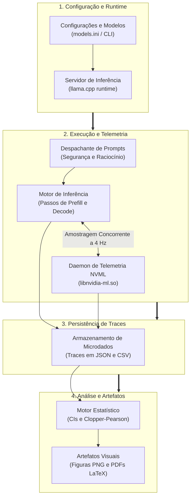
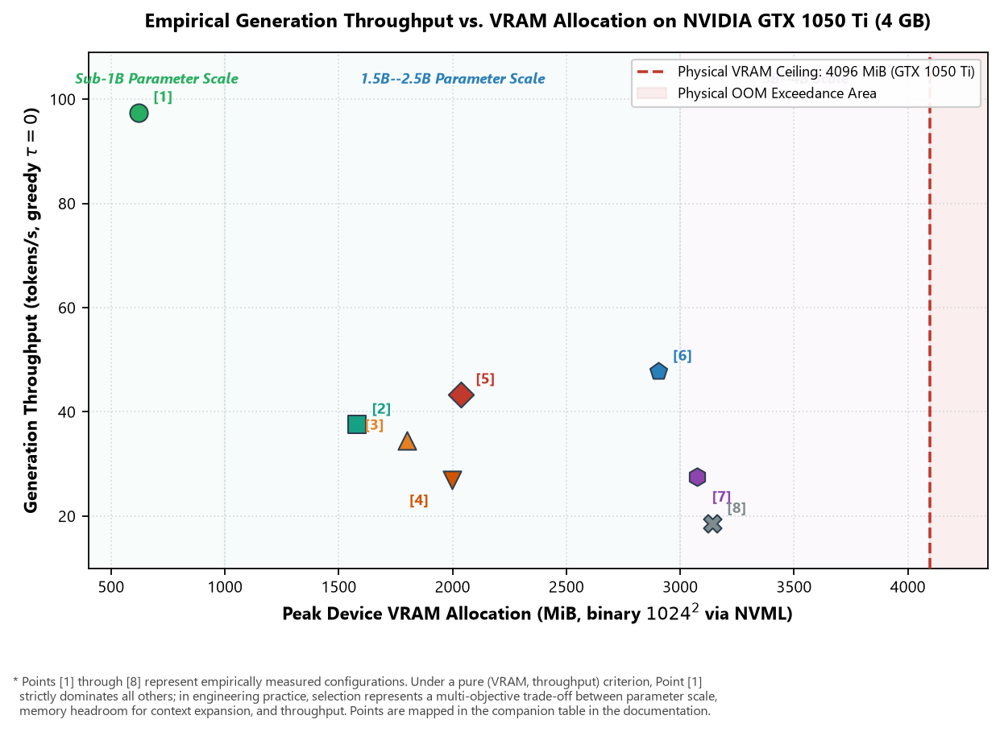
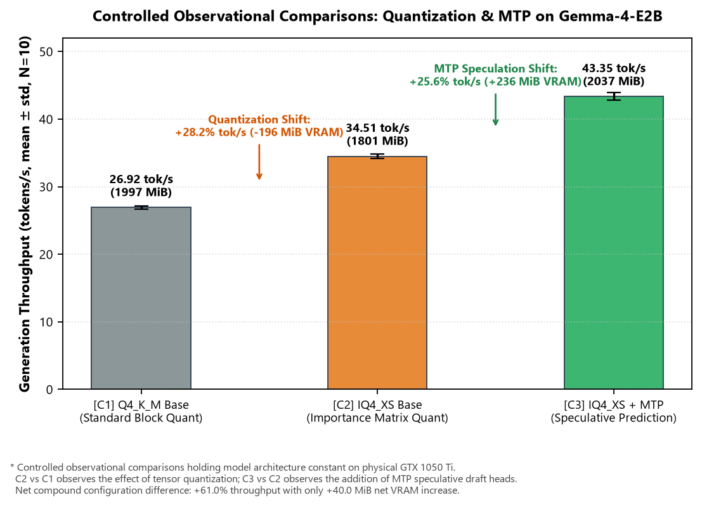

# LLM Research Bench

[](LICENSE)
[](pyproject.toml)
[](https://github.com/AndersonTavares0/llm-research-bench/actions/workflows/ci.yml)
[-red.svg)](reports/pt-BR/report_pt-BR.pdf)
[-red.svg)](reports/en-US/report_en-US.pdf)
[](README.pt-BR.md)
[](README.md)

> **Exploração Empírica de Modelos de Linguagem Pequenos (SLMs) sob Restrições Severas de Memória ($\le 4\text{ GiB}$ VRAM)**<br/>
> Um projeto pessoal, educacional e experimental de código aberto que investiga limites de memória, vazão de geração, decodificação especulativa e comportamento de segurança defensiva em uma GPU de entrada (NVIDIA GeForce GTX 1050 Ti de 4 GB).

**Autor:** Anderson Tavares (Graduando em Engenharia de Software e Ciência de Dados)<br/>
**Repositório do Projeto:** [https://github.com/AndersonTavares0/llm-research-bench](https://github.com/AndersonTavares0/llm-research-bench)<br/>
**Idioma:** **Português (Brasil)** | [English Version](README.md)

---

> [!NOTE]
> **Natureza do Projeto e Aviso Legal**<br/>
> Este é um projeto pessoal independente desenvolvido para aprendizado, experimentação e engenharia exploratória. Embora aplique benchmarks estruturados, temporização monotônica e cálculos estatísticos, **não se trata de uma publicação acadêmica revisada por pares**. Os resultados refletem o comportamento observado em uma bancada de testes física com GPU única e estão sujeitos a revisão contínua. Consulte [Limitações e Trabalho em Andamento](#5-metodologia-limitações-e-evolução) e a [Issue #2](https://github.com/AndersonTavares0/llm-research-bench/issues/2).

---

## Sumário

- [1. Visão Geral e Motivação](#1-visão-geral-e-motivação)
- [2. Arquitetura do Sistema e Fluxo](#2-arquitetura-do-sistema-e-fluxo)
- [3. Resultados Empíricos e Benchmarks](#3-resultados-empíricos-e-benchmarks)
- [4. Como Começar e Uso Prático](#4-como-começar-e-uso-prático)
- [5. Metodologia, Limitações e Evolução](#5-metodologia-limitações-e-evolução)

---

## 1. Visão Geral e Motivação

### O Que É Este Projeto?

O **LLM Research Bench** é uma bancada prática de experimentação e conjunto automatizado de ferramentas de medição projetado para avaliar **Modelos de Linguagem Pequenos (SLMs, com parâmetros entre 0,5B e 4B)** executados localmente em aceleradores físicos de consumo sob limites severos de memória ($\le 4096\text{ MiB}$ VRAM).

### Por Que Avaliar em uma GTX 1050 Ti de 4 GB?

Enquanto a pesquisa de ponta em IA foca majoritariamente em aceleradores corporativos de centros de dados (A100, H100), bilhões de dispositivos de borda e sistemas computacionais acessíveis dependem de hardware de consumo. A **NVIDIA GeForce GTX 1050 Ti (Pascal GP107, 4 GB GDDR5, 75W TDP)** serve como um rigoroso ambiente de teste de estresse físico porque:

1. **Limite Físico Rígido:** Um teto inflexível de 4096 MiB não deixa margem para sobrecarga de memória; os pesos estáticos consomem sozinhos de 40% a 76% do total de VRAM, restringindo drasticamente a expansão do cache Key-Value (KV).
2. **Zero Aceleração Tensorial:** A microarquitetura GP107 não possui Tensor Cores. O processamento em FP16 opera à taxa restrita de 1:64, tornando a geração autorregressiva de tokens estritamente limitada pela largura de banda do barramento GDDR5 ($112,0\text{ GB/s}$).
3. **Condições Reais de Borda:** Demonstra como técnicas de quantização não homogênea (`IQ4_XS`) e predição de múltiplos tokens (`MTP`) operam na prática em silício doméstico sem descarregamento para nuvens hiperdimensionadas.

### Escopo da Pesquisa e Perguntas Centrais

- **Impacto da Quantização:** Como quantizações baseadas em matriz de importância (`IQ4_XS`) se comparam a quantizações em bloco convencionais (`Q4_K_M`) em vazão de decode e pegada de VRAM?
- **Amortização Especulativa:** A predição de múltiplos tokens (MTP) confere ganhos práticos de velocidade em hardware limitado por memória sem necessidade de modelos auxiliares dedicados?
- **Sobretaxa Multilíngue:** Em que grau vocabulários compactos de tokenizadores penalizam a capacidade de contexto e a velocidade de resposta em idiomas não ingleses (português e mandarim)?
- **Robustez Defensiva:** Modelos compactos conseguem isolar confiavelmente contextos de ferramentas externas contra ataques de injeção de prompt em fluxos locais?

---

## 2. Arquitetura do Sistema e Fluxo

A suíte de testes organiza a leitura de configurações, checagens de prontidão, telemetria em segundo plano, envio de prompts e exportação estatística em um ciclo de quatro etapas:



### Componentes Principais do Pipeline

- [`benchmark_suite.py`](src/llm_research_bench/benchmark_suite.py): Orquestrador central com protocolo padronizado em 3 níveis (Nível A Smoke Test, Nível B Comparativo Intercalado, Nível C Estresse Térmico), perfis de tempo monotônicos e guardrails de temperatura.
- [`telemetry_collector.py`](src/llm_research_bench/telemetry_collector.py): Thread dedicada que consulta a biblioteca de gerenciamento da NVIDIA (`libnvidia-ml.so.1`) para registrar picos reais de VRAM, clocks do núcleo e temperatura da junção a 250 ms (4 Hz).
- [`statistical_engine.py`](src/llm_research_bench/statistical_engine.py): Módulo matemático para cálculo de intervalos de confiança Student-$t$ e intervalos binomiais exatos de Clopper-Pearson.
- [`generate_readme_figures.py`](src/llm_research_bench/generate_readme_figures.py): Gerador automatizado de gráficos PNG de alta resolução gerados diretamente a partir dos resultados experimentais.

---

## 3. Resultados Empíricos e Benchmarks

### Bancada Experimental de Referência

Todas as medições empíricas foram coletadas na bancada física dedicada:
- **GPU:** NVIDIA GeForce GTX 1050 Ti (4096 MiB GDDR5, barramento de 128 bits, 112,0 GB/s de banda, 768 núcleos CUDA, arquitetura Pascal GP107).
- **CPU e Memória Host:** AMD Ryzen 5 3600 (6C/12T @ 3.6 GHz base), 16 GiB DDR4 3200 MT/s.
- **Ambiente Isolado:** Container Debian 12 minimal com passthrough PCI direto (modo headless, sem X11 disputando VRAM).
- **Motor de Inferência:** `llama-server` (commit b4120+) com descarregamento cuBLAS e quantização GGUF.

### Tabela Comparativa Mestra (Configurações Avaliadas)

> [!IMPORTANT]
> **Modelos Fundacionais vs. Configurações Operacionais:**<br/>
> O benchmark avaliou **6 modelos fundacionais distintos** distribuídos em **8 configurações operacionais experimentais** (incluindo variações de quantização e variantes com decodificação especulativa MTP).

| Ponto | Modelo e Configuração Operacional | Arquitetura Fundacional | Formato / Quantização | Pico de VRAM (MiB) | % de 4 GiB | Vazão Decode (tok/s) | TTFT Estável (ms) | Demanda Analítica de Banda |
| :---: | :--- | :--- | :--- | :---: | :---: | :---: | :---: | :---: |
| **[1]** | **Qwen-2.5-0.5B** | Qwen2.5 (0,49B) | `Q4_K_M` | **620,7** | 15,2% | **97,47 ± 0,60** | **12,1** | 45,7 GB/s (40,8%) |
| **[2]** | **Qwen-3.5-2B** | Qwen (1,95B) | `Q4_K_XL` | 1580,7 | 38,6% | 37,60 ± 0,10 | 49,9 | 52,5 GB/s (46,9%) |
| **[3]** | **Gemma-4-E2B [C2]** | Gemma 2 (2,00B) | `IQ4_XS` Base | 1800,7 | 44,0% | 34,51 ± 0,29 | 88,0 | 60,0 GB/s (53,6%) |
| **[4]** | **Gemma-4-E2B [C1]** | Gemma 2 (2,00B) | `Q4_K_M` Base | 1996,7 | 48,7% | 26,92 ± 0,23 | 116,1 | 53,7 GB/s (47,9%) |
| **[5]** | **Gemma-4-E2B [C3]** | Gemma 2 (2,00B) | `IQ4_XS` + **MTP** | 2036,7 | 49,7% | **43,35 ± 0,57** | 73,5* | **75,3 GB/s (67,2%)** |
| **[6]** | **SmolLM2-1.7B** | LLaMA (1,71B) | `Q4_K_M` | 2902,7 | 70,9% | 47,80 ± 0,10 | 25,5 | 50,6 GB/s (45,2%) |
| **[7]** | **Llama-3.2-3B** | Llama 3.2 (3,21B) | `Q4_K_M` | 3074,7 | 75,1% | 27,59 ± 0,04 | 43,5 | 55,7 GB/s (49,7%) |
| **[8]** | **Qwen-3.5-4B** | Qwen (4,02B) | `Q4_K_M` | 3140,7 | 76,7% | 18,55 ± 0,10 | 129,8 | 47,8 GB/s (42,7%) |

*\* Nota sobre Inicialização a Frio (Cold-Start):* No primeiro ensaio sem aquecimento prévio, o Gemma-4-E2B apresentou latência de cold-start de 4142,2 ms decorrente da compilação JIT de kernels CUDA e alocação de buffers. Em regime estabilizado, a mediana caiu para 73,5 ms (p95: 2311,4 ms).

### Relação Vazão vs. Alocação de VRAM

O gráfico abaixo apresenta a vazão de geração (*decode* guloso, tokens/s) em relação ao pico de memória física de vídeo medido na GPU (MiB via NVML). Os pontos **[1] a [8]** correspondem diretamente à Tabela Comparativa Mestra acima:



> [!NOTE]
> **Critérios de Dominância e Compromissos de Engenharia:**<br/>
> Sob uma avaliação estritamente restrita à tupla bivariada `(min VRAM, max Vazão)`, o Ponto **[1] (Qwen-0.5B)** domina todos os demais pontos nesta bancada de testes. Entretanto, a seleção prática de modelos exige equilibrar velocidade com a escala de parâmetros e margem de memória para retenção de contexto. Os Pontos **[2]**, **[5]** e **[6]** representam configurações balanceadas para a escala de 2B parâmetros, enquanto modelos de 3B--4B (**[7]**, **[8]**) demandam mais de 75% da VRAM apenas para a carga estática dos tensores de pesos.

### Comparações Observacionais Controladas: Quantização e MTP

Para observar separadamente os efeitos da quantização e da decodificação especulativa, realizamos comparações controladas na mesma arquitetura base (**Gemma-4-E2B**) ao longo de 10 ensaios sequenciais ($\tau = 0,0$):



- **Mudança de Quantização (C2 vs. C1):** A transição do formato `Q4_K_M` para `IQ4_XS` (ambos sem especulação MTP) esteve associada a um **ganho de +28,2% na vazão** ($26,92 \to 34,51\text{ tok/s}$) e a uma **redução de 196,0 MiB** na VRAM de pico ($1996,7 \to 1800,7\text{ MiB}$).
- **Efeito Especulativo do MTP (C3 vs. C2):** Sob quantização constante em `IQ4_XS`, ativar as cabeças preditivas de MTP conferiu **+25,6% de vazão** adicional ($34,51 \to 43,35\text{ tok/s}$) com uma alocação de **+236,0 MiB** em tempo de execução para as estruturas de rascunho e verificação.
- **Diferença Composta de Configuração (C3 vs. C1):** O ganho acumulado entre a linha de base e a configuração otimizada alcançou **+61,0%** ($26,92 \to 43,35\text{ tok/s}$). Como a economia de 196 MiB da quantização absorveu 83% da pegada das cabeças de MTP, a variação líquida de memória foi de apenas **+40,0 MiB** ($1996,7 \to 2036,7\text{ MiB}$).

> [!NOTE]
> *Escopo Metodológico:* Trata-se de uma comparação observacional controlada sobre uma arquitetura específica em ambiente físico fixo, não constituindo demonstração causal generalizável para outros tipos de aceleradores.

### Destaques de Segurança Defensiva e Tokenização Multilíngue

- **Recusa Indevida em Prompts Benignos:** Em 4 prompts técnicos com termos de segurança da informação, todos os modelos testados obtiveram 0% de recusa indevida ($0/4$, $\text{FPR} = 0,0\%$, intervalo de confiança exato de Clopper-Pearson a 95% $[0,0\%, 60,2\%]$).
- **Injeções Indiretas de Prompt:** Modelos abaixo de 2B parâmetros exibiram vulnerabilidade acentuada a escapes de delimitadores embutidos no contexto ($\text{ASR} \approx 50\%\text{--}100\%$).
- **Interceptação de Chamadas de Ferramentas:** Quando prompts maliciosos tentaram invocar funções externas indevidas, o interceptor do harness bloqueou 100% das chamadas ($2/2$, $[15,8\%, 100,0\%]$), garantindo 0% de execução no sistema operacional.
- **Sobretaxa em Idiomas Não Ingleses:** O tamanho do vocabulário afeta drasticamente a eficiência útil. No SmolLM2 (vocabulário reduzido de 49k), o português exigiu $2,4\times$ mais tokens e o chinês exigiu $4,6\times$ mais tokens para expressar o mesmo conteúdo frente ao inglês, reduzindo a capacidade efetiva da janela de contexto de 4k para apenas $22\%$. Modelos com vocabulários mais amplos (Qwen2.5 com 152k, Gemma com 256k) retiveram entre 55% e 71% da capacidade útil.

---

## 4. Como Começar e Uso Prático

### Pré-requisitos e Configuração do Ambiente

- **Sistema:** Linux (Ubuntu 22.04 / Debian 12 recomendado) ou Windows 10/11 com Python 3.10+
- **GPU (Opcional para análise de dados):** GPU NVIDIA com driver proprietário instalado (para telemetria via NVML). Os scripts de benchmark suportam execução simulada sem GPU dedicada.
- **Git**

```bash
# Clone o repositório
git clone https://github.com/AndersonTavares0/llm-research-bench.git
cd llm-research-bench

# Crie e ative um ambiente virtual
python -m venv .venv
source .venv/bin/activate  # No Windows: .venv\Scripts\activate

# Instale o pacote em modo editável
pip install -e .
```

### Execução dos Testes Automatizados de Software

A base de código inclui suíte completa de testes unitários que valida motores estatísticos, parsers de telemetria, cálculos de Clopper-Pearson e guardrails de segurança:

```bash
# Executa todos os 64 testes unitários (execução verificada: conclui em ~0,2s)
python -m unittest discover -s tests -p "test_*.py"
```

### Execução de uma Passagem de Benchmark Ponta a Ponta

Para executar uma passagem de benchmark conectando-se a um servidor de inferência local ativo (ex.: `llama-server` em `http://127.0.0.1:18081`):

```bash
# Definindo o PYTHONPATH para src, ou instalando via pip install -e .
python src/llm_research_bench/benchmark_suite.py --base-url http://127.0.0.1:18081 --models gemma4:E2B --tier tier_a
```

*(Nota: Requer um endpoint ativo compatível com a API OpenAI ou llama.cpp. Em ambientes offline sem servidor em execução, utilize a suíte de testes automatizados acima para verificar todos os componentes e proteções.)*

### Regeneração de Gráficos e Figuras (PNG / PDF)

Todos os gráficos vetoriais em PDF e figuras PNG da documentação podem ser gerados diretamente a partir dos dados experimentais registrados:

```bash
# Gera imagens PNG para documentação (docs/images/) - execução verificada
python src/llm_research_bench/generate_readme_figures.py

# Gera figuras vetoriais PDF para os relatórios acadêmicos (reports/figures/) - execução verificada
python src/llm_research_bench/generate_figures.py
```

### Compilação dos Relatórios Técnicos (Tectonic)

As monografias científicas aprofundadas (20 e 30 páginas) podem ser compiladas via [Tectonic](https://tectonic-typesetting.github.io/):

```bash
# Compilação do relatório em inglês (reports/en-US/report_en-US.pdf) - execução verificada
tectonic reports/en-US/report_en-US.tex --outdir reports/en-US

# Compilação do relatório em português (reports/pt-BR/report_pt-BR.pdf) - execução verificada
tectonic reports/pt-BR/report_pt-BR.tex --outdir reports/pt-BR
```

---

## 5. Metodologia, Limitações e Evolução

### Estrutura do Repositório

```
llm-research-bench/
├── configs/                             # Matriz de experimentos e definições de modelos
│   ├── experiment_matrix.yaml
│   └── models.ini
├── datasets/                            # Datasets e baterias de prompts
│   ├── multilingual/                    # Corpus paralelo de referência multilíngue
│   ├── sensitive_topics/                # Bateria de avaliação em temas sensíveis
│   ├── agentic_tools.json               # Esquemas JSON de ferramentas
│   ├── defensive_safety_benchmarks.json # Sondas canárias de segurança defensiva
│   ├── model_provenance.json            # Hashes criptográficos SHA-256
│   └── reasoning_prompts.json           # Prompts de raciocínio
├── docs/                                # Documentação técnica e recursos visuais
│   ├── images/                          # Imagens PNG utilizadas no README
│   └── GOVERNANCE.md                    # Governança e princípios de contribuição
├── reports/                             # Monografias técnicas aprofundadas
│   ├── pt-BR/                           # Relatório em português (LaTeX e PDF)
│   ├── en-US/                           # Relatório em inglês (LaTeX e PDF)
│   └── figures/                         # Figuras vetoriais em PDF
├── results/                             # Microdados empíricos e telemetrias registradas
│   ├── controlled_experiments/          # Logs de ablação e resumos estatísticos
│   ├── model_quality/                   # Saídas pontuadas de segurança e raciocínio
│   └── system_performance/              # Métricas assíncronas do NVML e JSONs
├── src/llm_research_bench/              # Pacote Python principal do benchmark
│   ├── evaluators/                      # Módulos de avaliação (segurança, código, raciocínio)
│   ├── systems/                         # Perfiladores de cache KV e concorrência
│   ├── benchmark_suite.py               # Orquestrador padronizado em 3 níveis
│   ├── generate_figures.py              # Gerador de gráficos vetoriais em PDF
│   ├── generate_readme_figures.py       # Gerador de gráficos PNG para documentação
│   ├── statistical_engine.py            # Fórmulas de IC e Clopper-Pearson
│   └── telemetry_collector.py           # Coletor nativo de telemetria via NVML
├── tests/                               # 64 testes unitários (100% de aprovação)
├── CONTRIBUTING.md                      # Diretrizes para novos colaboradores
├── LICENSE                              # Licença MIT
├── pyproject.toml                       # Metadados e dependências do pacote
├── README.md                            # Documentação principal em inglês
└── README.pt-BR.md                      # Documentação principal em português
```

### Reprodutibilidade e Proveniência

Para permitir auditoria rigorosa, cada execução experimental armazena:
1. **Proveniência do Modelo:** Tamanho do arquivo GGUF, número de camadas, contexto configurado e hash criptográfico SHA-256 verificado (consulte [datasets/model_provenance.json](datasets/model_provenance.json)).
2. **Amostragem Determinística:** Inferência estritamente gulosa ($\tau = 0,0$) com semente fixa (`seed=42`).
3. **Telemetria de Execução:** Temporização por relógio monotônico em cada requisição, acompanhada por amostras NVML do hardware.
4. **Isolamento de Dados:** Dados de telemetria de sistema ficam em [`results/system_performance/`](results/system_performance/) e avaliações comportamentais em [`results/model_quality/`](results/model_quality/).

> [!WARNING]
> *Reprodutibilidade em Outros Hardwares:* Vazão em tokens/s e latências em milissegundos dependem do acelerador, versão do driver, temporizações de memória e temperatura ambiente. A execução em placas de vídeo diferentes apresentará valores numéricos distintos.

### Limitações Metodológicas Conhecidas

Em conformidade com a prática científica aberta, o projeto documenta explicitamente suas limitações metodológicas:

- **GPU Física Única (Pseudorreplicação):** Todas as repetições empíricas foram realizadas no mesmo nó físico com a GTX 1050 Ti. Os altos valores de significância estatística ($t$-test) refletem consistência interna estrita entre ensaios na mesma máquina, mas não capturam a variabilidade entre diferentes placas físicas (*Hurlbert, 1984*).
- **Amostras Canárias de Segurança Reduzidas ($N=10$):** Os testes de segurança defensiva e interceptação de ferramentas são sondas exploratórias de turno único para diagnosticar modos de falha. Não representam uma avaliação psicométrica exaustiva.
- **Demanda Analítica vs. Contadores Físicos de Banda:** A utilização da largura de banda é modelada de forma analítica ($B_{\text{demanda}} = S_{\text{pesos}} \times \text{Vazão}$), expressando a demanda teórica do modelo Roofline e não a medição direta por contadores de hardware da DRAM.
- **Deriva Térmica em Execuções Contínuas:** Em baterias ininterruptas, a temperatura da GPU subiu de $44^\circ\text{C}$ para $74^\circ\text{C}$, ativando o escalonamento dinâmico do NVIDIA GPU Boost 3.0 ($1695 \to 1607\text{ MHz}$, variação de $-5,2\%$). O protocolo de 3 níveis foi concebido para mitigar esse efeito em rodadas futuras.
- **Acompanhamento de Questões Abertas:** As discussões metodológicas e o planejamento das próximas etapas estão documentados na **[Issue #2: Pesquisa em andamento: revisão metodológica e novos experimentos](https://github.com/AndersonTavares0/llm-research-bench/issues/2)**.

### Relatórios Técnicos Completos e Citação

Para aprofundamento nas derivações teóricas (matemática da atenção de Vaswani et al., equações de escala de GQA, embeddings rotacionais RoPE e curvas de intensidade aritmética Roofline), consulte os relatórios técnicos integrais:

- 📄 **[Relatório Técnico em Português (PDF, 30 páginas)](reports/pt-BR/report_pt-BR.pdf)**: Monografia técnica completa em português.
- 📄 **[English Technical Monograph (PDF, 20 pages)](reports/en-US/report_en-US.pdf)**: Artigo completo de engenharia de sistemas.
- 🛡️ **[Política de Segurança](SECURITY.md)**: Orientações para relato de vulnerabilidades e testes defensivos.
- 🤝 **[Diretrizes de Contribuição](CONTRIBUTING.md)**: Instruções para envio de melhorias ao projeto.
- 🏛️ **[Governança do Projeto](docs/GOVERNANCE.md)**: Princípios e padrões de revisão do repositório.

Se você utilizar esta metodologia ou o conjunto de dados empíricos em sua pesquisa, cite conforme:

```bibtex
@article{tavares2026slmbench,
  title   = {Avaliação Reproduzível de Modelos de Linguagem Compactos sob Restrições Severas de Memória e Computação: Dinâmica Arquitetural, Fronteiras de Quantização, Decodificação Especulativa e Vulnerabilidades Adversariais em Bancada Experimental de Referência},
  author  = {Tavares, Anderson},
  journal = {Relatório Técnico e Monografia Aberta de Benchmark},
  year    = {2026},
  url     = {https://github.com/AndersonTavares0/llm-research-bench}
}
```

---

## Licença e Agradecimentos

Este projeto é software de código aberto licenciado sob a **[Licença MIT](LICENSE)**.

### Ferramentas e Recursos da Comunidade

- **[llama.cpp](https://github.com/ggerganov/llama.cpp)** (Georgi Gerganov e colaboradores): Motor de inferência de alto desempenho em C/C++.
- **[Tectonic](https://tectonic-typesetting.github.io/)**: Compilador moderno e autocontido de documentos LaTeX.
- **Comunidade Open-Weights:** Alibaba Cloud (Qwen), HuggingFace (SmolLM), Google DeepMind (Gemma) e Meta AI (Llama) pela disponibilização pública dos modelos.

---

*Este repositório é uma iniciativa educacional independente de Anderson Tavares. Não possui afiliação, endosso ou patrocínio oficial da NVIDIA, Google, Meta, Alibaba ou Microsoft.*
